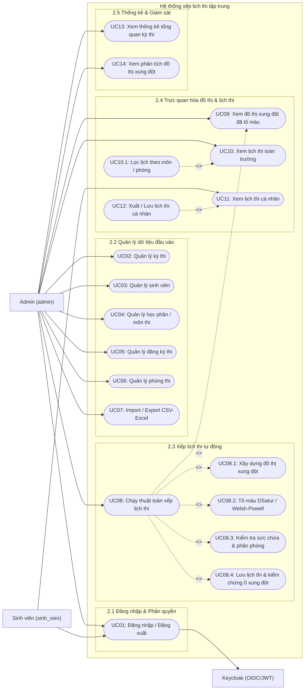

# Sơ đồ Use Case (Use Case Diagram)

---

## 1. Tác nhân (Actors)

| Tác nhân | Loại | Vai trò trong hệ thống |
|---|---|---|
| **Admin (`admin`)** | Tác nhân chính | Quản lý dữ liệu kỳ thi, chạy thuật toán xếp lịch, xem đồ thị xung đột, lịch thi toàn trường và thống kê |
| **Sinh viên (`sinh_vien`)** | Tác nhân chính | Đăng nhập xem lịch thi cá nhân và xuất/lưu lịch thi |
| **Keycloak** | Hệ thống ngoài (Tác nhân phụ) | Xác thực người dùng (OIDC/PKCE) và cấp JWT chứa vai trò (`admin`, `sinh_vien`) cùng `mssv` |

---

## 2. Sơ đồ Use Case tổng quát (Mermaid)

---

## 3. Bảng ánh xạ Use Case theo tài liệu chức năng

| Mã UC | Tên Use Case | Tác nhân | Tham chiếu mục 01 | Mô tả ngắn |
|---|---|---|---|---|
| **UC01** | Đăng nhập / Đăng xuất | Admin, Sinh viên, Keycloak | 2.1 | Xác thực qua Keycloak (OIDC/PKCE), lấy JWT chứa vai trò (`admin` / `sinh_vien`) và `mssv` để FastAPI phân quyền |
| **UC02** | Quản lý kỳ thi | Admin | 2.2 | Tạo và cấu hình kỳ thi (`ky_thi`): ngày bắt đầu, ngày kết thúc, số ca thi mỗi ngày |
| **UC03** | Quản lý sinh viên | Admin | 2.2 | Thêm, sửa, xóa, tìm kiếm sinh viên (`mssv`, `ho_ten`, `email`) |
| **UC04** | Quản lý học phần / môn thi | Admin | 2.2 | Quản lý danh mục môn thi (`ma_mon`, `ten_mon`, `thoi_luong`) |
| **UC05** | Quản lý đăng ký thi | Admin | 2.2 | Quản lý danh sách sinh viên dự thi từng môn trong kỳ thi (`dang_ky`) |
| **UC06** | Quản lý phòng thi | Admin | 2.2 | Quản lý danh mục phòng thi và sức chứa tối đa (`ma_phong`, `suc_chua`) |
| **UC07** | Import / Export dữ liệu hàng loạt | Admin | 2.2 | Tải lên/xuất file CSV/Excel cho sinh viên, môn học, đăng ký thi |
| **UC08** | Chạy thuật toán xếp lịch thi | Admin | 2.3 | Khởi chạy xếp lịch tự động cho kỳ thi (chọn DSatur hoặc đối chứng Welsh–Powell); bao gồm 4 bước `<<include>>`: dựng đồ thị $G=(V,E)$, tô màu tìm $\chi(G)$, kiểm tra sức chứa & phân phòng (First-Fit Decreasing), lưu `ca_thi`/`lich_thi` và kiểm chứng 0 xung đột |
| **UC09** | Xem đồ thị xung đột đã tô màu | Admin | 2.4 | Xem đồ thị trên Cytoscape.js (nút = môn, cạnh = xung đột, màu = ca thi), xem bậc đỉnh và số SV chung khi chọn nút/cạnh; hỗ trợ bấm nút **"Xếp lịch"** để chạy lại UC08 |
| **UC10** | Xem lịch thi toàn trường | Admin | 2.4 | Xem lịch thi dạng ngày/tuần/tháng trên FullCalendar (giờ thi, môn thi, phòng thi, số SV); hỗ trợ lọc theo môn học hoặc phòng thi (`UC10.1`) |
| **UC11** | Xem lịch thi cá nhân | Sinh viên | 1, 2.1, 2.4 | Xem lịch thi dạng ngày/tuần/tháng của riêng các học phần đã đăng ký (đối chiếu `mssv` từ JWT) |
| **UC12** | Xuất / Lưu lịch thi cá nhân | Sinh viên | 1 | Xuất hoặc lưu lại lịch thi cá nhân từ màn hình xem lịch |
| **UC13** | Xem thống kê tổng quan kỳ thi | Admin | 2.5 | Xem tổng số môn thi, tổng số sinh viên, số ca thi tối thiểu $\chi(G)$, trạng thái xung đột (0%) trên biểu đồ Chart.js |
| **UC14** | Xem phân tích đồ thị xung đột | Admin | 2.5 | Xem danh sách/biểu đồ các môn có bậc cao nhất và phân bố số lượng môn thi trong ngày của sinh viên |

