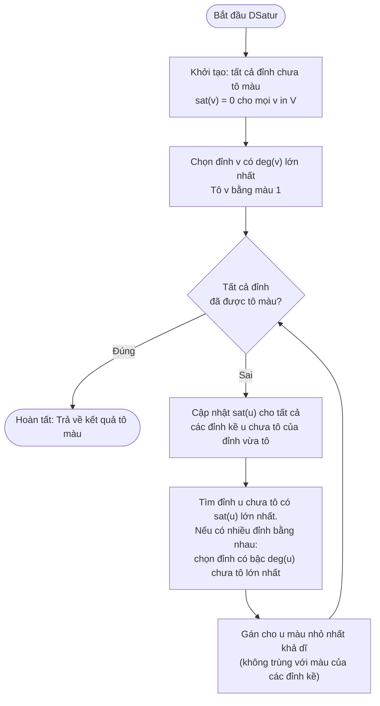
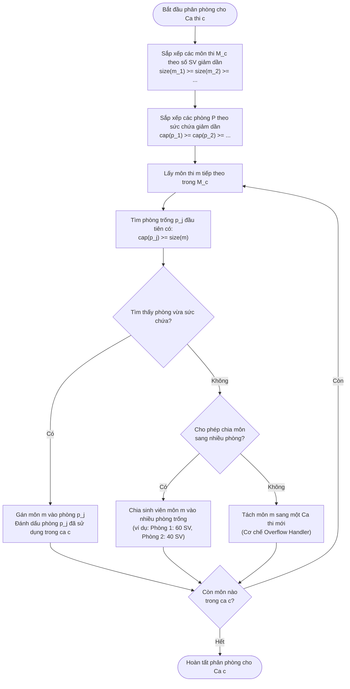
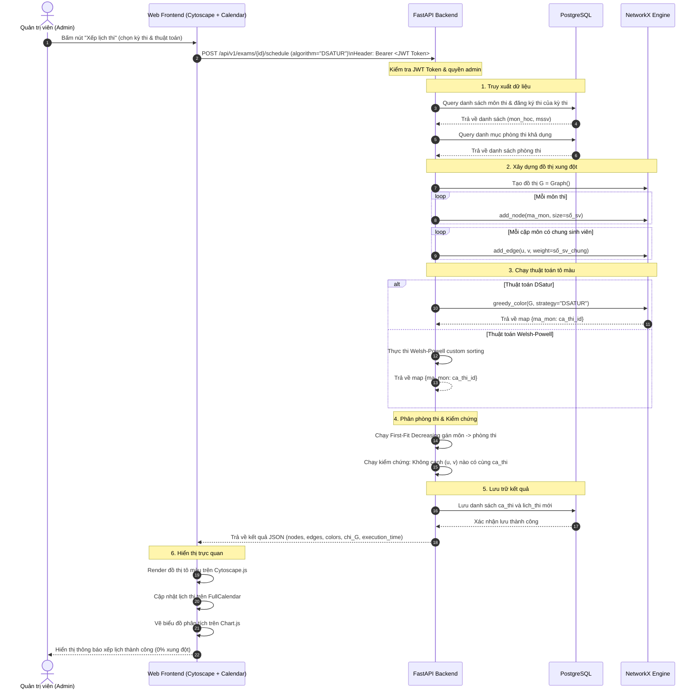

# Kiến trúc hệ thống và thuật toán (System Architecture & Algorithms)

**Dự án:** Hệ thống xếp lịch thi tập trung bằng thuật toán tô màu đồ thị  
**Tài liệu tham chiếu liên quan:** [01. Product features.md](./01.%20Product%20features.md) · [02. Use case diagram.md](./02.%20Use%20case%20diagram.md) · [10. Technology stack.md](./10.%20Technology%20stack.md)

---

## 1. Kiến trúc hệ thống tổng thể (High-Level Architecture)

Hệ thống được thiết kế theo mô hình **Kiến trúc phân tầng tinh gọn (Lean Layered Architecture)**, được đóng gói và vận hành đồng bộ thông qua **3 Docker Services** (`caddy`, `fastapi`, `postgres`) theo đặc tả tại [10. Technology stack.md](./10.%20Technology%20stack.md):

```mermaid
flowchart TD
    subgraph CLIENT["1. Presentation Layer (Trình duyệt Người dùng)"]
        UI_Admin["Admin Dashboard\n(HTML5, CSS, JS)"]
        UI_SV["Sinh viên Portal\n(HTML5, CSS, JS)"]
        Cyto["Cytoscape.js\n(Trực quan hóa đồ thị)"]
        Calendar["FullCalendar\n(Hiển thị lịch thi)"]
        Charts["Chart.js\n(Biểu đồ phân tích)"]
        
        UI_Admin --> Cyto
        UI_Admin --> Calendar
        UI_Admin --> Charts
        UI_SV --> Calendar
    end

    subgraph GATEWAY["2. Gateway & Proxy Layer"]
        Caddy["Caddy Reverse Proxy\n(HTTPS tự động, Định tuyến cổng 80/443, Phân phối Static UI)"]
    end

    subgraph APP["3. Application & Business Logic Layer (FastAPI Backend)"]
        API_Gateway["FastAPI ASGI App"]
        
        subgraph AUTH["Auth & Security"]
            Auth_Service["Native JWT Auth Service\n(OAuth2 Password Flow, PyJWT, Bcrypt)"]
            Role_Guard["Role-Based Access Control\n(Kiểm tra quyền admin / sinh_vien qua JWT)"]
        end

        subgraph MODULES["Core Modules"]
            Exam_Service["Exam & Master Data Service\n(Kỳ thi, môn học, sinh viên, phòng)"]
            Graph_Builder["Graph Conflict Builder\n(Dựng đồ thị xung đột G = V, E)"]
            Scheduler["Algorithm Engine\n(Tô màu DSatur & Welsh-Powell)"]
            Room_Allocator["Room Allocator\n(First-Fit Decreasing / Bin Packing)"]
            Verifier["Schedule Verifier\n(Kiểm chứng 0% xung đột)"]
        end
        
        NetworkX["NetworkX Library\n(Cấu trúc đồ thị & thuật toán đồ thị)"]
    end

    subgraph PERSISTENCE["4. Persistence Layer (Database)"]
        Postgres[(PostgreSQL 16\nBảng: nguoi_dung, ky_thi, mon_hoc,\nsinh_vien, dang_ky, phong, ca_thi, lich_thi)]
    end

    %% Luồng kết nối
    CLIENT -->|HTTPS (Port 443)| Caddy
    Caddy -->|Proxy /api/*| API_Gateway
    Caddy -->|Serve static files| CLIENT
    
    API_Gateway --> Auth_Service
    Auth_Service --> Role_Guard
    Role_Guard --> MODULES
    
    Scheduler <--> NetworkX
    Graph_Builder <--> NetworkX
    
    Auth_Service --> Postgres
    Exam_Service --> Postgres
    Graph_Builder -->|Đọc danh sách đăng ký thi| Postgres
    Room_Allocator -->|Đọc danh mục phòng| Postgres
    Verifier -->|Ghi kết quả ca_thi & lich_thi| Postgres
```

### 1.1. Chi tiết các tầng kiến trúc

1. **Tầng Trình diễn (Presentation Layer - Frontend):**
   - Xây dựng bằng HTML5, CSS và Vanilla JavaScript (ES6+), không cần cấu hình build tool phức tạp (như Webpack hay Vite), giúp các thành viên frontend làm việc trực tiếp, sửa là thấy ngay kết quả.
   - **Cytoscape.js:** Xử lý và render đồ thị xung đột dưới dạng canvas/WebGL tương tác mượt mà, hỗ trợ zoom, kéo thả node, hiển thị trọng số cạnh và màu sắc ca thi.
   - **FullCalendar:** Kết xuất dữ liệu lịch thi thành dạng ngày/tuần/tháng trực quan, hỗ trợ xem chi tiết ca thi và phòng thi.
   - **Chart.js:** Trực quan hóa các chỉ số phân tích đồ thị (phân phối bậc đỉnh, tỉ lệ lấp đầy phòng, so sánh thời gian chạy thuật toán).

2. **Tầng Cổng mạng (Gateway Layer - Caddy Server):**
   - Đóng vai trò Reverse Proxy làm điểm tiếp nhận duy nhất từ bên ngoài qua cổng 80/443.
   - Tự động quản lý SSL/TLS (HTTPS) thông qua cơ chế tự động của Caddy.
   - Định tuyến `/api/*` về FastAPI Backend và phục vụ trực tiếp các file tĩnh của giao diện (HTML/CSS/JS).

3. **Tầng Nghiệp vụ (Application Layer - FastAPI):**
   - Viết bằng **Python 3.11+** trên nền tảng **FastAPI**, tận dụng khả năng xử lý bất đồng bộ (Asynchronous ASGI).
   - **Xác thực JWT nội bộ:** Đăng nhập qua endpoint `/api/v1/auth/login`, mật khẩu băm bằng `bcrypt`, cấp JWT token ngắn gọn chứa `sub`, `role` (`admin` hoặc `sinh_vien`) và `mssv`.
   - **Pydantic v2:** Xác thực kiểu dữ liệu đầu vào/đầu ra và tự sinh Swagger UI tương tác tại `/docs`.
   - **NetworkX:** Khởi tạo cấu trúc dữ liệu đồ thị trong bộ nhớ, tính toán ma trận kề, bậc đỉnh và thực thi thuật toán tô màu đồ thị.

4. **Tầng Dữ liệu (Persistence Layer - PostgreSQL):**
   - Sử dụng **PostgreSQL 16** để lưu trữ quan hệ bền vững với tính toàn vẹn dữ liệu (ACID).
   - Đảm bảo hiệu năng truy vấn nhanh cho bài toán ghép cặp sinh viên đăng ký môn thi để dựng đồ thị.

---

## 2. Công nghệ sử dụng & Cơ sở lựa chọn (Tech Stack Justification)

| Thành phần | Công nghệ lựa chọn | Lý do lựa chọn & Phù hợp cho nhóm 5 người / 1 tháng |
|---|---|---|
| **Backend Framework** | **FastAPI (Python)** | Tốc độ cao, dễ học, tích hợp hoàn hảo với thư viện khoa học dữ liệu (NetworkX). Viết API và tự sinh Swagger UI ngay lập tức. |
| **Graph Processing** | **NetworkX** | Thư viện đồ thị số 1 của Python, có sẵn cấu trúc đồ thị vô hướng có trọng số và thuật toán `greedy_color(strategy="DSATUR")`, giúp tiết kiệm hàng trăm giờ code thuật toán nền tảng. |
| **Cơ sở dữ liệu & ORM** | **PostgreSQL 16 & SQLAlchemy / psycopg** | Đáng tin cậy, quan hệ chuẩn mực, hỗ trợ câu lệnh JOIN tối ưu để quét xung đột sinh viên đăng ký thi. SQLAlchemy giúp thao tác CSDL an toàn, chống SQL Injection. |
| **Xử lý file dữ liệu** | **openpyxl & csv** | Thư viện Python chuẩn để đọc/ghi file Excel (.xlsx) và CSV phục vụ chức năng Import/Export dữ liệu hàng loạt. |
| **Xác thực & Phân quyền** | **Native JWT (FastAPI + PyJWT + Passlib/Bcrypt)** | **Lựa chọn tinh giản tối ưu:** Thay vì dùng Keycloak nặng nề dễ lỗi cấu hình, nhóm tự kiểm soát 100% mã nguồn xác thực chỉ trong 1 file `auth.py`. Đăng nhập nhanh, nhẹ RAM, dễ dàng debug. |
| **Reverse Proxy** | **Caddy** | Cấu hình siêu ngắn (khoảng 10 dòng Caddyfile), tự động cấp HTTPS, không cần cài đặt Certbot phức tạp như Nginx. |
| **Trực quan hóa đồ thị** | **Cytoscape.js** | Thư viện chuyên biệt cho mạng lưới đồ thị; hỗ trợ layout tự động, kéo thả đỉnh, đổi màu tức thì theo ca thi. |
| **Giao diện lịch thi** | **FullCalendar** | Thư viện lịch thi chuẩn quốc tế, hiển thị dạng tuần/tháng/ngày mượt mà, chỉ cần nạp mảng sự kiện JSON từ API. |

---

## 3. Mô hình hóa toán học bài toán xếp lịch thi

Bài toán xếp lịch thi (Exam Timetabling Problem) được mô hình hóa toán học thành **Bài toán tô màu đỉnh đồ thị (Vertex Coloring Problem)** kết hợp **Ràng buộc đóng gói thùng (Bin Packing Problem)**.

### 3.1. Định nghĩa không gian bài toán

Cho một kỳ thi với các tập dữ liệu:
* Tập các môn thi cần xếp: $M = \{m_1, m_2, \dots, m_n\}$.
* Tập các sinh viên tham gia: $S = \{s_1, s_2, \dots, s_p\}$.
* Quan hệ đăng ký thi: $R \subseteq S \times M$, trong đó $(s, m) \in R$ nghĩa là sinh viên $s$ đăng ký dự thi môn $m$.
* Tập các phòng thi khả dụng: $P = \{p_1, p_2, \dots, p_q\}$, mỗi phòng có sức chứa tối đa $\text{cap}(p_j) \in \mathbb{N}^+$.

### 3.2. Chuyển đổi sang đồ thị xung đột $G = (V, E)$

Xây dựng đồ thị vô hướng có trọng số $G = (V, E, W)$:
1. **Tập đỉnh $V$:** Mỗi đỉnh $v_i \in V$ tương ứng với một môn thi $m_i \in M$ ($|V| = n$).
2. **Tập cạnh $E$:** Tồn tại cạnh $e = (u, v) \in E$ khi và chỉ khi có ít nhất một sinh viên đăng ký cả hai môn $u$ và $v$:
   $$E = \{ (u, v) \in V \times V \mid u \ne v \text{ và } \exists s \in S: (s, u) \in R \land (s, v) \in R \}$$
3. **Trọng số cạnh $W$:** Trọng số $w(u, v)$ thể hiện mức độ xung đột (số lượng sinh viên chung giữa hai môn):
   $$w(u, v) = |\{ s \in S \mid (s, u) \in R \land (s, v) \in R \}|$$
4. **Trọng số đỉnh (Số thí sinh dự thi):**
   $$\text{size}(u) = |\{ s \in S \mid (s, u) \in R \}|$$

### 3.3. Bài toán tô màu đỉnh & Các ràng buộc

Tìm hàm ánh xạ gán màu (gán ca thi) $c: V \to \{1, 2, \dots, k\}$:

* **Ràng buộc cứng 1 (Hard Constraint - Tuyệt đối không trùng lịch):** Hai môn có xung đột không bao giờ được xếp cùng ca thi:
  $$\forall (u, v) \in E \implies c(u) \ne c(v)$$
* **Ràng buộc cứng 2 (Sức chứa phòng thi):** Tổng số sinh viên thi trong cùng một ca $c$ không vượt quá tổng sức chứa của toàn bộ các phòng thi sẵn có trong ca đó:
  $$\forall c \in \{1, \dots, k\}: \sum_{u \in V, c(u) = c} \text{size}(u) \le \sum_{p \in P} \text{cap}(p)$$
* **Hàm mục tiêu (Objective Function):** Cực tiểu hóa số lượng ca thi $k$ (tiệm cận sắc số $\chi(G)$ của đồ thị):
  $$\min k \quad \text{sao cho } k \ge \chi(G)$$

---

## 4. Chi tiết các thuật toán tô màu đồ thị

Để giải bài toán tô màu đồ thị (NP-khó) trong thời gian thực thi mili-giây, hệ thống triển khai thuật toán phỏng đoán Heuristic **DSatur** làm thuật toán chính và **Welsh–Powell** làm đối chứng.

### 4.1. Thuật toán DSatur (Degree of Saturation)

Được đề xuất bởi Daniel Brélaz (1979), **DSatur** là một trong những thuật toán Heuristic tô màu đồ thị hiệu quả và chính xác nhất cho các đồ thị thực tế.

#### Khái niệm then chốt:
1. **Bậc của đỉnh $\deg(v)$:** Số đỉnh kề với đỉnh $v$ trong đồ thị $G$.
2. **Độ bão hòa màu $\text{sat}(v)$:** Số lượng **màu khác nhau** đã được gán cho các đỉnh kề với đỉnh $v$.
   $$\text{sat}(v) = |\{ c(u) \mid u \in \text{Adj}(v) \text{ và } u \text{ đã được tô màu} \}|$$

#### Ý tưởng & Chiến lược:
DSatur **cập nhật động** độ ưu tiên tô màu sau mỗi bước. Đỉnh nào có $\text{sat}(v)$ cao nhất tức là đỉnh đó "bị hạn chế chọn màu nhất", do đó phải được ưu tiên tô trước để tránh bế tắc hoặc phát sinh thêm màu mới.



#### Mã giả (Pseudo-code) của DSatur:

```text
Algorithm DSatur(G = (V, E)):
    Input: Đồ thị xung đột G = (V, E)
    Output: Bản đồ phân ca màu c: V -> {1, 2, ..., k}

    1. Khởi tạo mảng color[v] = None với mọi v in V
    2. Khởi tạo sat[v] = 0 với mọi v in V
    3. Chọn đỉnh v0 có bậc deg(v0) lớn nhất trong V
    4. color[v0] = 1
    5. Cập nhật sat[u] cho các đỉnh u kề với v0

    6. While còn đỉnh chưa tô màu:
    7.     Tập hợp C = {u in V | color[u] == None có sat[u] lớn nhất}
    8.     Nếu |C| > 1:
    9.         u* = đỉnh trong C có số đỉnh kề chưa tô lớn nhất
    10.    Ngược lại:
    11.        u* = phần tử duy nhất trong C
    12.    
    13.    Màu_kề = {color[w] | w in Adj(u*) và color[w] != None}
    14.    color[u*] = màu nguyên dương nhỏ nhất không thuộc Màu_kề
    15.    Cập nhật lại sat[w] cho tất cả w in Adj(u*) chưa tô
    
    16. Return color
```

* **Độ phức tạp tính toán:** $O(|V|^2)$ với mảng thông thường, hoặc $O((|V| + |E|) \log |V|)$ khi sử dụng hàng đợi ưu tiên.
* **Cài đặt trong dự án:** Tận dụng trực tiếp hàm `nx.greedy_color(G, strategy="DSATUR")` từ NetworkX.

---

### 4.2. Thuật toán Welsh–Powell (Thuật toán đối chứng)

Là thuật toán tham lam tĩnh (Static Greedy) cổ điển:

#### Các bước thực hiện:
1. **Bước 1:** Tính bậc của tất cả các đỉnh $\deg(v)$. Sắp xếp danh sách đỉnh theo thứ tự bậc giảm dần: $\deg(v_1) \ge \deg(v_2) \ge \dots \ge \deg(v_n)$.
2. **Bước 2:** Bắt đầu với màu đầu tiên $c = 1$.
3. **Bước 3:** Duyệt qua danh sách các đỉnh chưa tô:
   - Tô màu $c$ cho đỉnh đầu tiên chưa tô.
   - Tiếp tục duyệt các đỉnh còn lại, tô màu $c$ cho bất kỳ đỉnh nào **không kề** với các đỉnh đã được tô màu $c$ trong lượt này.
4. **Bước 4:** Nếu vẫn còn đỉnh chưa tô, tăng $c = c + 1$ và lặp lại Bước 3 cho các đỉnh còn lại.
5. **Bước 5:** Kết thúc khi tất cả các đỉnh đã được gán màu.

#### So sánh DSatur vs Welsh–Powell:

| Tiêu chí | DSatur (Thuật toán chính) | Welsh–Powell (Đối chứng) |
|---|---|---|
| **Cơ chế chọn đỉnh** | Động (theo mức độ bão hòa màu $\text{sat}$) | Tĩnh (chỉ dựa vào bậc ban đầu) |
| **Chất lượng số màu** | Tối ưu hoặc sát với sắc số $\chi(G)$ | Khá, dễ tốn thêm ca thi nếu đồ thị dày |
| **Độ phức tạp** | $O(|V|^2)$ hoặc $O(|E| \log |V|)$ | $O(|V| \log |V| + |E|)$ |
| **Ứng dụng trong dự án** | Xếp lịch thi thực tế để tối ưu ca | Chạy đối chứng để phân tích và đánh giá |

> [!TIP]
> **Cài đặt trong NetworkX:** Trong thư viện NetworkX, thuật toán Welsh–Powell được tích hợp sẵn thông qua chiến lược `largest_first`:
> ```python
> coloring_welsh_powell = nx.greedy_color(G, strategy="largest_first")
> ```
> Điều này giúp nhóm dễ dàng gọi và đối chiếu trực tiếp giữa DSatur (`strategy="DSATUR"`) và Welsh–Powell mà không cần cài đặt lại thuật toán từ đầu.

---

## 5. Thuật toán phân bổ phòng thi (First-Fit Decreasing)

Sau khi tô màu đồ thị, ta thu được tập các ca thi $C = \{1, 2, \dots, k\}$. Với mỗi ca thi $c$, tập các môn thi diễn ra đồng thời là:
$$M_c = \{ v \in V \mid \text{color}(v) = c \}$$

Để xếp các môn thi này vào các phòng thi cụ thể $P = \{p_1, p_2, \dots, p_q\}$, hệ thống áp dụng thuật toán **First-Fit Decreasing (FFD)**:



### Chiến lược xử lý khi quá tải sức chứa (Capacity Overflow Strategy):
1. **Chia phòng (Room Splitting):** Nếu môn thi có số sinh viên lớn hơn sức chứa phòng lớn nhất, chia thành các phòng cùng ca.
2. **Tách ca (Shift Spilling):** Nếu tổng sinh viên trong ca vượt quá tổng sức chứa toàn trường, môn có bậc xung đột thấp nhất sẽ được chuyển sang ca mới.

---

## 6. Luồng xử lý dữ liệu tổng thể (End-to-End Execution Pipeline)

Biểu đồ tuần tự dưới đây thể hiện toàn bộ vòng đời từ khi Quản trị viên kích hoạt nút **"Xếp lịch"** trên giao diện:



---

## 7. Phân chia công việc cho nhóm 5 thành viên (Timeline 4 tuần)

| Thành viên | Phụ trách chính | Nhiệm vụ cụ thể |
|---|---|---|
| **Thành viên 1** | **Lõi thuật toán & NetworkX** | Viết module dựng đồ thị xung đột, tích hợp DSatur, viết hàm Welsh-Powell đối chứng, viết thuật toán phân phòng First-Fit Decreasing và hàm kiểm chứng 0% xung đột. |
| **Thành viên 2** | **Backend & Database** | Thiết kế CSDL PostgreSQL, viết các API CRUD cho môn học, sinh viên, phòng thi, kỳ thi và module Import/Export CSV/Excel. |
| **Thành viên 3** | **Frontend Bố cục & FullCalendar** | Xây dựng bố cục Web Admin/Sinh viên, tích hợp FullCalendar để hiển thị lịch thi toàn trường và lịch cá nhân, gắn Chart.js thống kê. |
| **Thành viên 4** | **Frontend Cytoscape.js** | Xây dựng màn hình trực quan hóa đồ thị xung đột, cấu hình bố cục (layout), đổi màu nút theo ca thi, tương tác click xem thông tin môn thi và bậc đỉnh. |
| **Thành viên 5** | **Auth, DevOps & Tài liệu** | Viết module xác thực Native JWT (Bcrypt + OAuth2 Password Flow), cấu hình Docker-compose (PostgreSQL, Caddy), đóng gói HTTPS và hoàn thiện tài liệu/báo cáo. |
