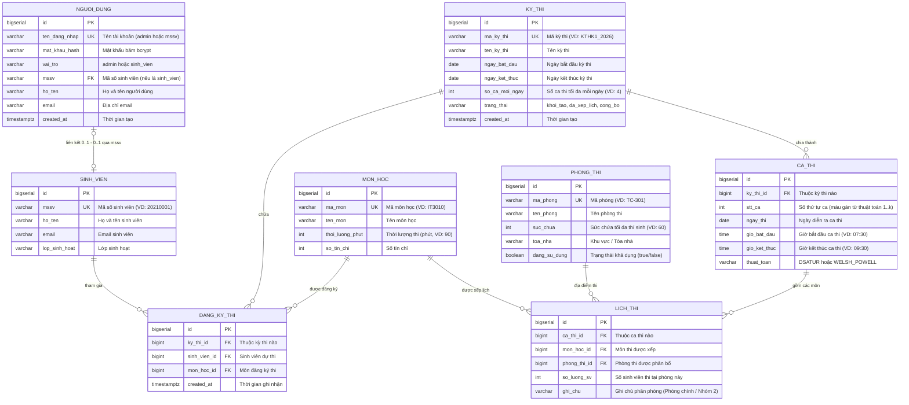
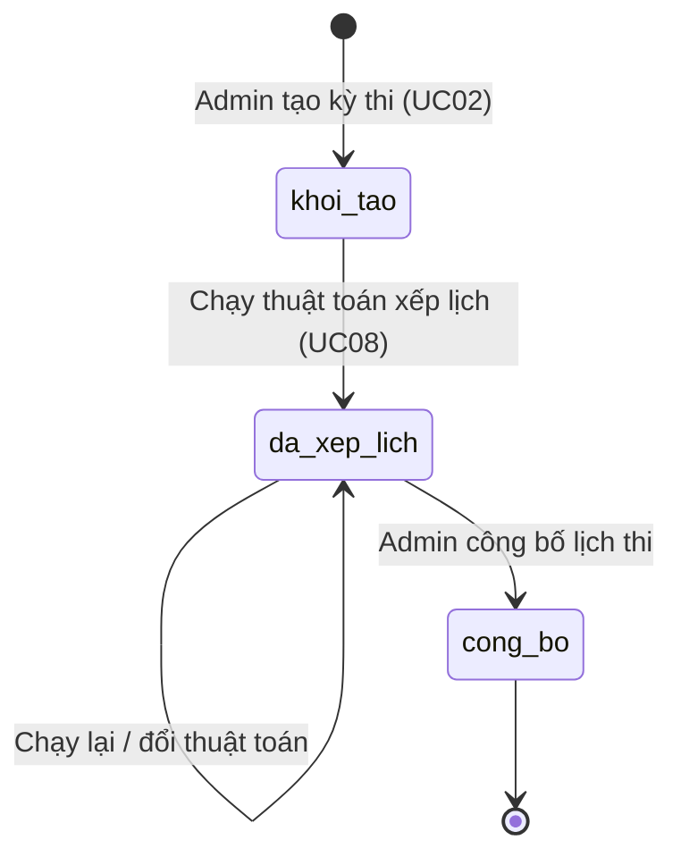
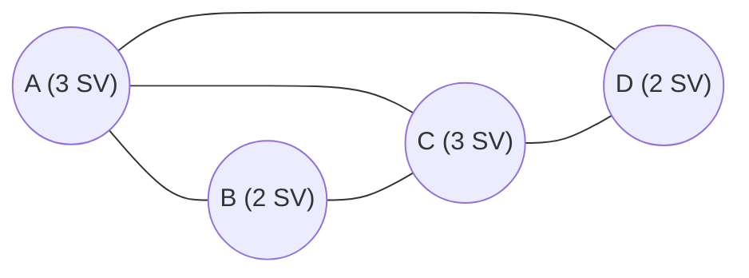
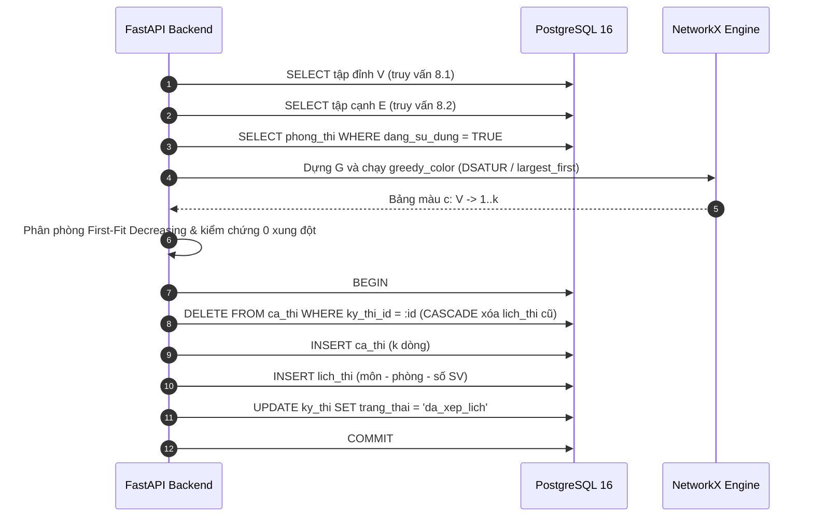

# CHƯƠNG: THIẾT KẾ CƠ SỞ DỮ LIỆU (DATABASE DESIGN & SCHEMA)

**Đề tài:** Hệ thống xếp lịch thi tập trung bằng thuật toán tô màu đồ thị  

---

## 1. Giới thiệu & Nguyên tắc thiết kế

Cơ sở dữ liệu (CSDL) là tầng lưu trữ (*Persistence Layer*) của hệ thống, vận hành trên **PostgreSQL 16** trong container Docker (`postgres`). Tầng nghiệp vụ **FastAPI** giao tiếp với CSDL thông qua **SQLAlchemy / psycopg** để đảm nhiệm 3 vai trò cốt lõi:

1. **Lưu trữ dữ liệu danh mục và đầu vào:** tài khoản người dùng, kỳ thi, môn học, sinh viên, phòng thi và danh sách đăng ký dự thi.
2. **Cung cấp dữ liệu dựng đồ thị xung đột $G = (V, E, W)$:** sử dụng truy vấn tổng hợp (`GROUP BY`, `Self-Join`) có chỉ mục để trích xuất tập đỉnh, tập cạnh và trọng số xung đột trong vài mili-giây.
3. **Lưu trữ kết quả xếp lịch thi:** các ca thi (tương ứng các *màu* từ thuật toán DSatur / Welsh–Powell) và lịch thi chi tiết theo từng phòng (từ thuật toán First-Fit Decreasing).

### Nguyên tắc thiết kế

| Nguyên tắc | Nội dung áp dụng |
|---|---|
| **Chuẩn hóa 3NF** | Đảm bảo toàn vẹn dữ liệu, không dư thừa và nhất quán khi thêm/sửa/xóa. |
| **Quy ước đặt tên** | Toàn bộ tên bảng và tên cột viết thường, phân cách bằng dấu gạch dưới (`snake_case`), tiếng Việt không dấu (`sinh_vien`, `dang_ky_thi`, `phong_thi`, …). |
| **Khóa chính thay thế** | Mọi bảng dùng `id BIGSERIAL` làm khóa chính. Các mã nghiệp vụ (`ten_dang_nhap`, `ma_ky_thi`, `ma_mon`, `mssv`, `ma_phong`) gắn ràng buộc `UNIQUE`. |
| **Tối ưu cho bài toán đồ thị** | Đánh chỉ mục tổng hợp chuyên biệt trên `dang_ky_thi` để truy vấn `Self-Join` tìm cặp môn xung đột đạt tốc độ cao, không đánh chỉ mục trùng lặp với các cột đã có `UNIQUE`. |
| **Tính toàn vẹn ACID** | Kết hợp chặt chẽ `FOREIGN KEY`, `CHECK`, `UNIQUE` và giao dịch (`TRANSACTION`) khi ghi đè lịch thi. |

---

## 2. Phân tích yêu cầu dữ liệu

Ánh xạ trực tiếp từ các nhóm chức năng ([01. Product features.md](./01.%20Product%20features.md)) và Use Case ([02. Use case diagram.md](./02.%20Use%20case%20diagram.md)), hệ thống quản lý **8 bảng** chia làm **3 nhóm**:

| Nhóm | Use Case liên quan | Dữ liệu cần lưu | Bảng |
|---|---|---|---|
| **Xác thực** | UC01 | Tên đăng nhập, mật khẩu băm (`bcrypt`), vai trò (`admin` / `sinh_vien`), liên kết MSSV | `nguoi_dung` |
| **Danh mục & Đầu vào** | UC02 | Mã/tên kỳ thi, ngày bắt đầu/kết thúc, số ca mỗi ngày, trạng thái vòng đời | `ky_thi` |
| | UC03 | MSSV, họ tên, email, lớp sinh hoạt | `sinh_vien` |
| | UC04 | Mã môn, tên môn, thời lượng thi (phút), số tín chỉ | `mon_hoc` |
| | UC05, UC07 | Quan hệ sinh viên $s$ đăng ký thi môn $m$ trong kỳ thi $k$ | `dang_ky_thi` |
| | UC06 | Mã phòng, tên phòng, sức chứa tối đa, tòa nhà, trạng thái khả dụng | `phong_thi` |
| **Kết quả xếp lịch** | UC08 | Ca thi tương ứng từng màu $1..k$, ngày giờ thi, thuật toán đã dùng | `ca_thi` |
| | UC08 – UC12 | Phân bổ chi tiết môn thi – ca thi – phòng thi – số lượng sinh viên | `lich_thi` |

---

## 3. Mô hình dữ liệu mức khái niệm (ERD)

### 3.1. Sơ đồ Thực thể – Liên kết (Entity Relationship Diagram)



### 3.2. Mô tả các mối liên kết

| Liên kết | Bản số | Ý nghĩa nghiệp vụ |
|---|---|---|
| `nguoi_dung` – `sinh_vien` | `0..1 : 0..1` | Mỗi tài khoản `sinh_vien` gắn với đúng một hồ sơ sinh viên qua `mssv`; tài khoản `admin` có `mssv = NULL`. |
| `ky_thi` – `dang_ky_thi` | `1 : N` | Một kỳ thi chứa nhiều bản ghi đăng ký dự thi. |
| `sinh_vien` – `dang_ky_thi` – `mon_hoc` | `N : M` (qua bảng trung gian) | Trong mỗi kỳ thi, một sinh viên đăng ký nhiều môn và một môn có nhiều sinh viên đăng ký. |
| `ky_thi` – `ca_thi` | `1 : N` | Một kỳ thi được chia thành $k$ ca thi (tương ứng $k$ màu từ thuật toán tô màu). |
| `ca_thi` – `lich_thi` | `1 : N` | Một ca thi tổ chức đồng thời nhiều môn (các môn không chung sinh viên) ở các phòng khác nhau. |
| `mon_hoc` – `lich_thi` | `1 : N` | Một môn thi có thể được chia vào nhiều phòng (*Room Splitting*) nếu số thí sinh lớn hơn sức chứa 1 phòng. |
| `phong_thi` – `lich_thi` | `1 : N` | Một phòng thi được sử dụng qua nhiều ca thi khác nhau (tối đa 1 môn trong cùng 1 ca). |

### 3.3. Ánh xạ giữa mô hình toán học đồ thị và CSDL

Đồ thị xung đột $G = (V, E, W)$ **không được lưu cố định** trong CSDL nhằm tránh dư thừa và lệch dữ liệu, mà được **suy xuất động lúc chạy** từ bảng `dang_ky_thi`:

| Khái niệm toán học | Biểu diễn trong PostgreSQL |
|---|---|
| Tập môn thi $M$, tập đỉnh $V$ | Các `mon_hoc_id` phân biệt trong `dang_ky_thi` của `ky_thi_id` đang xét |
| Tập sinh viên $S$ | Các `sinh_vien_id` phân biệt trong `dang_ky_thi` |
| Quan hệ đăng ký $R \subseteq S \times M$ | Từng dòng trong `dang_ky_thi` (cùng `ky_thi_id`) |
| Trọng số đỉnh $\text{size}(u)$ | `COUNT(sinh_vien_id)` gom nhóm theo `mon_hoc_id` |
| Cạnh $(u, v) \in E$ & trọng số $w(u, v)$ | `Self-Join` bảng `dang_ky_thi` theo `sinh_vien_id`, đếm số sinh viên chung |
| Màu $c(v) \in \{1..k\}$ | `ca_thi.stt_ca` |
| Tập phòng $P$ & sức chứa $\text{cap}(p)$ | Bảng `phong_thi` (`dang_su_dung = TRUE`), cột `suc_chua` |
| Kết quả phân phòng (Bin Packing – FFD) | Bảng `lich_thi` (`ca_thi_id`, `mon_hoc_id`, `phong_thi_id`, `so_luong_sv`) |

---

## 4. Mô hình dữ liệu mức logic & Đánh giá chuẩn hóa

Ký hiệu: khóa chính **in đậm**, khóa ngoại *in nghiêng*, `(UK)` là cột mang ràng buộc `UNIQUE`.

- **nguoi_dung**(**id**, ten_dang_nhap (UK), mat_khau_hash, vai_tro, *mssv* (UK), ho_ten, email, created_at)
- **ky_thi**(**id**, ma_ky_thi (UK), ten_ky_thi, ngay_bat_dau, ngay_ket_thuc, so_ca_moi_ngay, trang_thai, created_at)
- **mon_hoc**(**id**, ma_mon (UK), ten_mon, thoi_luong_phut, so_tin_chi)
- **sinh_vien**(**id**, mssv (UK), ho_ten, email, lop_sinh_hoat)
- **dang_ky_thi**(**id**, *ky_thi_id*, *sinh_vien_id*, *mon_hoc_id*, created_at) — với `UK(ky_thi_id, sinh_vien_id, mon_hoc_id)`
- **phong_thi**(**id**, ma_phong (UK), ten_phong, suc_chua, toa_nha, dang_su_dung)
- **ca_thi**(**id**, *ky_thi_id*, stt_ca, ngay_thi, gio_bat_dau, gio_ket_thuc, thuat_toan) — với `UK(ky_thi_id, stt_ca)`
- **lich_thi**(**id**, *ca_thi_id*, *mon_hoc_id*, *phong_thi_id*, so_luong_sv, ghi_chu) — với `UK(ca_thi_id, phong_thi_id)`

### Đánh giá mức độ chuẩn hóa
- **Đạt 1NF:** Mọi thuộc tính đều nguyên tố, không chứa nhóm lặp (mỗi cặp sinh viên – môn thi là một dòng riêng trong `dang_ky_thi`).
- **Đạt 2NF:** Mọi bảng đều dùng khóa chính đơn (`id`), không tồn tại phụ thuộc hàm bộ phận.
- **Đạt 3NF:** Mọi thuộc tính không khóa chỉ phụ thuộc trực tiếp vào khóa chính; thông tin sinh viên và môn học không bị lặp lại ở `dang_ky_thi` hay `lich_thi`.
- **Thuộc tính lưu trữ có chủ đích:** `lich_thi.so_luong_sv` là kết quả của thuật toán phân phòng FFD (khi chia 1 môn ra nhiều phòng, số thí sinh từng phòng không thể suy trực tiếp từ `dang_ky_thi` nên bắt buộc lưu lại).

---

## 5. Từ điển dữ liệu chi tiết (Data Dictionary)

### 5.1. Bảng `nguoi_dung` — Tài khoản & Phân quyền (FastAPI Native JWT)

| Tên cột | Kiểu dữ liệu | Ràng buộc | Mô tả |
|---|---|---|---|
| `id` | `BIGSERIAL` | `PRIMARY KEY` | Khóa chính tự tăng |
| `ten_dang_nhap` | `VARCHAR(50)` | `NOT NULL, UNIQUE` | Tên đăng nhập (`admin` hoặc MSSV) |
| `mat_khau_hash` | `VARCHAR(255)` | `NOT NULL` | Chuỗi băm mật khẩu bằng `bcrypt` |
| `vai_tro` | `VARCHAR(20)` | `NOT NULL, CHECK (vai_tro IN ('admin','sinh_vien'))` | Quyền hạn, được ký vào JWT payload |
| `mssv` | `VARCHAR(20)` | `NULL, UNIQUE, REFERENCES sinh_vien(mssv) ON DELETE SET NULL` | Liên kết 0..1 – 0..1 với hồ sơ sinh viên (bắt buộc `NOT NULL` khi `vai_tro = 'sinh_vien'`) |
| `ho_ten` | `VARCHAR(100)` | `NOT NULL` | Họ và tên người dùng |
| `email` | `VARCHAR(100)` | `NULL` | Địa chỉ email liên lạc |
| `created_at` | `TIMESTAMPTZ` | `DEFAULT CURRENT_TIMESTAMP` | Thời điểm tạo tài khoản |

### 5.2. Bảng `ky_thi` — Thông tin đợt thi

| Tên cột | Kiểu dữ liệu | Ràng buộc | Mô tả |
|---|---|---|---|
| `id` | `BIGSERIAL` | `PRIMARY KEY` | Khóa chính định danh kỳ thi |
| `ma_ky_thi` | `VARCHAR(50)` | `NOT NULL, UNIQUE` | Mã kỳ thi ngắn gọn (VD: `KTHK1_2026`) |
| `ten_ky_thi` | `VARCHAR(255)` | `NOT NULL` | Tên đầy đủ của kỳ thi |
| `ngay_bat_dau` | `DATE` | `NOT NULL` | Ngày bắt đầu tổ chức thi |
| `ngay_ket_thuc` | `DATE` | `NOT NULL, CHECK (ngay_ket_thuc >= ngay_bat_dau)` | Ngày kết thúc kỳ thi |
| `so_ca_moi_ngay` | `INT` | `NOT NULL, DEFAULT 4, CHECK (so_ca_moi_ngay > 0)` | Số ca thi tối đa mỗi ngày (thường 3–4 ca) |
| `trang_thai` | `VARCHAR(20)` | `NOT NULL, DEFAULT 'khoi_tao', CHECK IN ('khoi_tao','da_xep_lich','cong_bo')` | Trạng thái vòng đời kỳ thi |
| `created_at` | `TIMESTAMPTZ` | `DEFAULT CURRENT_TIMESTAMP` | Thời điểm tạo kỳ thi |

**Vòng đời trạng thái kỳ thi:**



### 5.3. Bảng `mon_hoc` — Danh mục môn thi

| Tên cột | Kiểu dữ liệu | Ràng buộc | Mô tả |
|---|---|---|---|
| `id` | `BIGSERIAL` | `PRIMARY KEY` | Khóa chính môn học |
| `ma_mon` | `VARCHAR(20)` | `NOT NULL, UNIQUE` | Mã môn học (VD: `IT3010`, `TTH101`) |
| `ten_mon` | `VARCHAR(255)` | `NOT NULL` | Tên học phần |
| `thoi_luong_phut` | `INT` | `NOT NULL, DEFAULT 90, CHECK (thoi_luong_phut > 0)` | Thời gian làm bài (phút) |
| `so_tin_chi` | `INT` | `DEFAULT 3, CHECK (so_tin_chi > 0)` | Số tín chỉ |

### 5.4. Bảng `sinh_vien` — Danh sách sinh viên

| Tên cột | Kiểu dữ liệu | Ràng buộc | Mô tả |
|---|---|---|---|
| `id` | `BIGSERIAL` | `PRIMARY KEY` | Khóa chính sinh viên |
| `mssv` | `VARCHAR(20)` | `NOT NULL, UNIQUE` | Mã số sinh viên duy nhất |
| `ho_ten` | `VARCHAR(100)` | `NOT NULL` | Họ và tên sinh viên |
| `email` | `VARCHAR(100)` | `NULL` | Email sinh viên |
| `lop_sinh_hoat` | `VARCHAR(50)` | `NULL` | Lớp sinh hoạt / lớp danh nghĩa |

### 5.5. Bảng `dang_ky_thi` — Danh sách đăng ký thi (Đầu vào dựng đồ thị)

| Tên cột | Kiểu dữ liệu | Ràng buộc | Mô tả |
|---|---|---|---|
| `id` | `BIGSERIAL` | `PRIMARY KEY` | Khóa chính bản ghi đăng ký |
| `ky_thi_id` | `BIGINT` | `NOT NULL, REFERENCES ky_thi(id) ON DELETE CASCADE` | Kỳ thi tương ứng |
| `sinh_vien_id` | `BIGINT` | `NOT NULL, REFERENCES sinh_vien(id) ON DELETE CASCADE` | Sinh viên dự thi |
| `mon_hoc_id` | `BIGINT` | `NOT NULL, REFERENCES mon_hoc(id) ON DELETE CASCADE` | Môn thi đăng ký |
| `created_at` | `TIMESTAMPTZ` | `DEFAULT CURRENT_TIMESTAMP` | Thời điểm ghi nhận |

> [!IMPORTANT]
> Ràng buộc duy nhất `uq_dang_ky UNIQUE (ky_thi_id, sinh_vien_id, mon_hoc_id)` là bắt buộc để ngăn một sinh viên đăng ký cùng một môn 2 lần trong một kỳ thi, đảm bảo trọng số cạnh xung đột $w(u,v)$ và số thí sinh $\text{size}(u)$ không bị đếm sai.

### 5.6. Bảng `phong_thi` — Danh mục phòng thi

| Tên cột | Kiểu dữ liệu | Ràng buộc | Mô tả |
|---|---|---|---|
| `id` | `BIGSERIAL` | `PRIMARY KEY` | Khóa chính phòng thi |
| `ma_phong` | `VARCHAR(50)` | `NOT NULL, UNIQUE` | Mã phòng thi (VD: `TC-301`, `A2-101`) |
| `ten_phong` | `VARCHAR(100)` | `NOT NULL` | Tên mô tả phòng thi |
| `suc_chua` | `INT` | `NOT NULL, CHECK (suc_chua > 0)` | Sức chứa tối đa $\text{cap}(p)$ |
| `toa_nha` | `VARCHAR(50)` | `NULL` | Tòa nhà / khu vực |
| `dang_su_dung` | `BOOLEAN` | `NOT NULL, DEFAULT TRUE` | Phòng có sẵn sàng để xếp lịch thi hay không |

### 5.7. Bảng `ca_thi` — Ca thi (Tương ứng màu của đồ thị)

| Tên cột | Kiểu dữ liệu | Ràng buộc | Mô tả |
|---|---|---|---|
| `id` | `BIGSERIAL` | `PRIMARY KEY` | Khóa chính ca thi |
| `ky_thi_id` | `BIGINT` | `NOT NULL, REFERENCES ky_thi(id) ON DELETE CASCADE` | Kỳ thi tương ứng |
| `stt_ca` | `INT` | `NOT NULL, CHECK (stt_ca > 0)` | Số thứ tự ca, chính là màu $1, 2, \dots, k$ |
| `ngay_thi` | `DATE` | `NOT NULL` | Ngày thi thực tế |
| `gio_bat_dau` | `TIME` | `NOT NULL` | Giờ bắt đầu (VD: `07:30:00`) |
| `gio_ket_thuc` | `TIME` | `NOT NULL, CHECK (gio_ket_thuc > gio_bat_dau)` | Giờ kết thúc (VD: `09:30:00`) |
| `thuat_toan` | `VARCHAR(30)` | `NOT NULL, DEFAULT 'DSATUR', CHECK IN ('DSATUR','WELSH_POWELL')` | Thuật toán đã dùng để sinh ca |

**Quy tắc quy đổi màu `stt_ca` sang ngày & giờ thi:** Với `so_ca_moi_ngay` $= n$, ca thứ $c = \text{stt\_ca} \ge 1$ được xếp vào ngày:
$$\text{ngay\_thi} = \text{ngay\_bat\_dau} + \left\lfloor \frac{c - 1}{n} \right\rfloor \quad \text{và khung giờ thứ } ((c - 1) \bmod n) + 1 \text{ trong ngày đó.}$$

### 5.8. Bảng `lich_thi` — Lịch thi chi tiết & Phân phòng

| Tên cột | Kiểu dữ liệu | Ràng buộc | Mô tả |
|---|---|---|---|
| `id` | `BIGSERIAL` | `PRIMARY KEY` | Khóa chính lịch thi |
| `ca_thi_id` | `BIGINT` | `NOT NULL, REFERENCES ca_thi(id) ON DELETE CASCADE` | Ca thi diễn ra |
| `mon_hoc_id` | `BIGINT` | `NOT NULL, REFERENCES mon_hoc(id) ON DELETE CASCADE` | Môn thi được xếp |
| `phong_thi_id` | `BIGINT` | `NOT NULL, REFERENCES phong_thi(id) ON DELETE RESTRICT` | Phòng thi được chỉ định |
| `so_luong_sv` | `INT` | `NOT NULL, CHECK (so_luong_sv > 0)` | Số lượng sinh viên thi tại phòng này |
| `ghi_chu` | `VARCHAR(255)` | `NULL` | Ghi chú phân phòng (VD: `"Phòng chính"`, `"Nhóm 2"`) |

> [!NOTE]
> Khóa ngoại `phong_thi_id` dùng `ON DELETE RESTRICT` để ngăn xóa nhầm phòng đang có lịch thi (muốn ngừng dùng phòng chỉ cần đặt `dang_su_dung = FALSE`). Đồng thời ràng buộc `UNIQUE (ca_thi_id, phong_thi_id)` đảm bảo một phòng chỉ phục vụ tối đa một môn trong cùng một ca thi.

---

## 6. Tổng hợp ràng buộc toàn vẹn

### 6.1. Ràng buộc thực thi trực tiếp tại PostgreSQL
- **Khóa chính & Duy nhất:** `id BIGSERIAL` ở 8 bảng; `UNIQUE` trên các mã nghiệp vụ (`ten_dang_nhap`, `ma_ky_thi`, `ma_mon`, `mssv`, `ma_phong`), `uq_dang_ky (ky_thi_id, sinh_vien_id, mon_hoc_id)`, `uq_ca_thi (ky_thi_id, stt_ca)`, `uq_lich_phong (ca_thi_id, phong_thi_id)`.
- **Miền giá trị (`CHECK`):** `vai_tro IN ('admin','sinh_vien')`, `ck_sv_co_mssv`, `trang_thai IN ('khoi_tao','da_xep_lich','cong_bo')`, `ngay_ket_thuc >= ngay_bat_dau`, `gio_ket_thuc > gio_bat_dau`, `thuat_toan IN ('DSATUR','WELSH_POWELL')`, `so_ca_moi_ngay > 0`, `suc_chua > 0`, `so_luong_sv > 0`.
- **Toàn vẹn tham chiếu:** `ON DELETE CASCADE` cho `dang_ky_thi`, `ca_thi`, `lich_thi` (xóa kỳ thi tự dọn dữ liệu con); `ON DELETE RESTRICT` cho `lich_thi.phong_thi_id`; `ON DELETE SET NULL` cho `nguoi_dung.mssv`.

### 6.2. Ràng buộc nghiệp vụ liên bảng (kiểm tra tại FastAPI `Schedule Verifier`)
1. **Ràng buộc cứng 1 (0 xung đột):** $\forall (u, v) \in E \implies c(u) \ne c(v)$ — không có sinh viên nào thi 2 môn trong cùng một `ca_thi`.
2. **Ràng buộc cứng 2 (Tổng sức chứa):** tổng `so_luong_sv` trong cùng một `ca_thi` $\le \sum \text{suc\_chua}$ của các phòng có `dang_su_dung = TRUE`.
3. **Đủ thí sinh:** tổng `lich_thi.so_luong_sv` của từng môn trên các phòng phải đúng bằng số sinh viên đăng ký môn đó trong `dang_ky_thi`.
4. **Giới hạn từng phòng:** mọi dòng `lich_thi` phải thỏa `lich_thi.so_luong_sv <= phong_thi.suc_chua`.

---

## 7. Chiến lược đánh chỉ mục (Indexing Strategy)

PostgreSQL đã tự động tạo B-tree index cho mọi khóa chính (`PRIMARY KEY`) và cột `UNIQUE` (`ten_dang_nhap`, `mssv`, `ma_mon`, `ma_phong`, `ma_ky_thi`), do đó hệ thống chỉ tạo bổ sung **5 chỉ mục trọng yếu** phục vụ dựng đồ thị và tra cứu lịch thi:

```sql
-- 1. Tối ưu đếm số SV mỗi môn (tập đỉnh V) và Self-Join tìm cạnh xung đột (tập cạnh E)
CREATE INDEX IF NOT EXISTS idx_dang_ky_thi_ky_thi_mon ON dang_ky_thi(ky_thi_id, mon_hoc_id);
CREATE INDEX IF NOT EXISTS idx_dang_ky_thi_ky_thi_sv  ON dang_ky_thi(ky_thi_id, sinh_vien_id);

-- 2. Tối ưu truy vấn ca thi theo kỳ thi và lịch thi trên FullCalendar
CREATE INDEX IF NOT EXISTS idx_ca_thi_ky_thi          ON ca_thi(ky_thi_id);
CREATE INDEX IF NOT EXISTS idx_lich_thi_ca_thi        ON lich_thi(ca_thi_id);
CREATE INDEX IF NOT EXISTS idx_lich_thi_mon_hoc       ON lich_thi(mon_hoc_id);
```

---

## 8. Các câu truy vấn SQL cốt lõi & Ví dụ minh họa

### 8.1. Trích xuất tập đỉnh $V$ và trọng số $\text{size}(u)$

```sql
SELECT
    m.id      AS mon_id,
    m.ma_mon,
    m.ten_mon,
    COUNT(dk.sinh_vien_id) AS so_luong_sv
FROM mon_hoc m
JOIN dang_ky_thi dk ON m.id = dk.mon_hoc_id
WHERE dk.ky_thi_id = :ky_thi_id
GROUP BY m.id, m.ma_mon, m.ten_mon;
```

### 8.2. Trích xuất tập cạnh $E$ và trọng số $w(u, v)$ (Self-Join tối ưu)

```sql
SELECT
    dk1.mon_hoc_id AS mon_u,
    dk2.mon_hoc_id AS mon_v,
    COUNT(dk1.sinh_vien_id) AS trong_so_xung_dot
FROM dang_ky_thi dk1
JOIN dang_ky_thi dk2
  ON dk1.sinh_vien_id = dk2.sinh_vien_id
 AND dk1.ky_thi_id    = dk2.ky_thi_id
 AND dk1.mon_hoc_id   < dk2.mon_hoc_id
WHERE dk1.ky_thi_id = :ky_thi_id
GROUP BY dk1.mon_hoc_id, dk2.mon_hoc_id;
```

> Điều kiện `dk1.mon_hoc_id < dk2.mon_hoc_id` đồng thời loại bỏ cạnh lặp đối xứng (đồ thị vô hướng) và loại trừ cạnh tự khuyên ($u \ne v$).

### 8.3. Ví dụ minh họa chuyển đổi từ `dang_ky_thi` sang đồ thị

Giả sử có 5 sinh viên đăng ký: `SV1(A, B)`, `SV2(A, C)`, `SV3(B, C)`, `SV4(C, D)`, `SV5(A, D)`.
- **Kết quả truy vấn 8.1 (Đỉnh):** `A (3 SV)`, `B (2 SV)`, `C (3 SV)`, `D (2 SV)`.
- **Kết quả truy vấn 8.2 (Cạnh):** `(A,B)=1`, `(A,C)=1`, `(A,D)=1`, `(B,C)=1`, `(C,D)=1`.



Vì `{A, B, C}` tạo thành tam giác ($K_3$) nên sắc số $\chi(G) = 3$. Một cách tô hợp lệ là **A = Ca 1**, **C = Ca 2**, **B & D = Ca 3** → bảng `ca_thi` có 3 dòng (`stt_ca = 1, 2, 3`) và `lich_thi` có ít nhất 4 dòng (nhiều hơn nếu có môn bị chia phòng).

### 8.4. Truy vấn lịch thi cá nhân của sinh viên (UC11)

Tham số `:mssv` được trích xuất trực tiếp từ **JWT payload** (không nhận từ query string client gửi lên):

```sql
SELECT ct.ngay_thi, ct.gio_bat_dau, ct.gio_ket_thuc,
       m.ma_mon, m.ten_mon, p.ma_phong, p.toa_nha
FROM sinh_vien sv
JOIN dang_ky_thi dk ON dk.sinh_vien_id = sv.id
JOIN ca_thi ct      ON ct.ky_thi_id    = dk.ky_thi_id
JOIN lich_thi lt    ON lt.ca_thi_id    = ct.id AND lt.mon_hoc_id = dk.mon_hoc_id
JOIN phong_thi p    ON p.id            = lt.phong_thi_id
JOIN mon_hoc m      ON m.id            = dk.mon_hoc_id
WHERE sv.mssv = :mssv
  AND dk.ky_thi_id = :ky_thi_id
ORDER BY ct.ngay_thi, ct.gio_bat_dau;
```

> [!TIP]
> **Hướng mở rộng khi chia phòng (*Room Splitting*):** Khi 1 môn được chia ra nhiều phòng, truy vấn trên hiển thị tất cả các phòng của môn đó. Nếu cần chỉ định chính xác *từng sinh viên ngồi phòng nào*, chỉ cần bổ sung thêm 1 bảng phụ `phan_phong_sv (lich_thi_id, sinh_vien_id)`.

---

## 9. Luồng giao dịch ACID khi lưu kết quả xếp lịch

Toàn bộ thao tác xóa lịch cũ và ghi lịch mới được bọc trong **một giao dịch (`TRANSACTION`) duy nhất** để đảm bảo tính nguyên tử (**Atomicity**): nếu xảy ra lỗi ở bất kỳ bước nào, hệ thống tự `ROLLBACK` và giữ nguyên lịch thi cũ.



---

## 10. Phân quyền truy cập dữ liệu

Phân quyền được thực thi tại tầng ứng dụng (**FastAPI Role Guard**) dựa trên `vai_tro` và `mssv` trong JWT (`HS256`), mật khẩu chỉ lưu dạng băm `bcrypt`:

| Bảng | Admin (`admin`) | Sinh viên (`sinh_vien`) |
|---|---|---|
| `nguoi_dung` | Toàn quyền | Chỉ đọc thông tin tài khoản của chính mình |
| `ky_thi`, `mon_hoc`, `phong_thi` | Toàn quyền (CRUD, import) | Chỉ đọc (khi kỳ thi đã công bố) |
| `sinh_vien`, `dang_ky_thi` | Toàn quyền (CRUD, import CSV/Excel) | Chỉ đọc dữ liệu có `mssv` trùng JWT |
| `ca_thi`, `lich_thi` | Ghi (qua UC08), đọc toàn trường | Chỉ đọc lịch thi các môn bản thân đã đăng ký |

