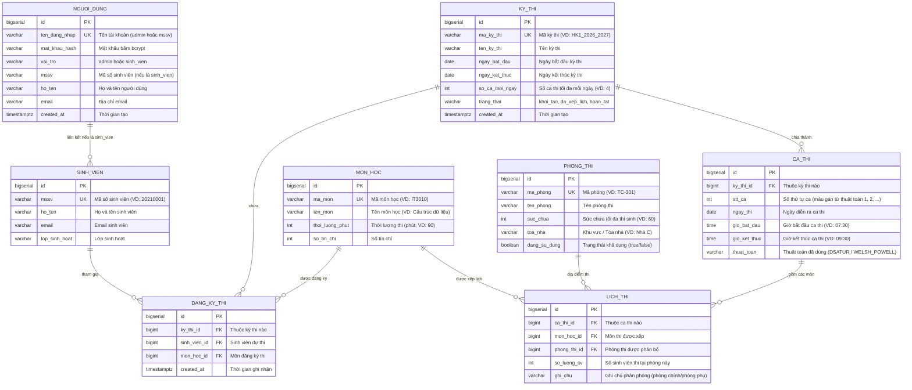

# Thiết kế Cơ sở dữ liệu (Database Design & Schema)

**Dự án:** Hệ thống xếp lịch thi tập trung bằng thuật toán tô màu đồ thị  
**Tài liệu tham chiếu:** [01. Product features.md](./01.%20Product%20features.md) · [02. Use case diagram.md](./02.%20Use%20case%20diagram.md) · [03. Architecture and algorithms.md](./03.%20Architecture%20and%20algorithms.md) · [10. Technology stack.md](./10.%20Technology%20stack.md)

---

## 1. Tổng quan thiết kế CSDL

Hệ thống sử dụng **PostgreSQL 16** với các nguyên tắc thiết kế chuẩn:
* **Chuẩn hóa dữ liệu (3NF):** Đảm bảo tính toàn vẹn dữ liệu, tránh dư thừa và nhất quán khi cập nhật.
* **Quy ước đặt tên:** Sử dụng chữ thường, phân cách bằng dấu gạch dưới (`snake_case`) cho tên bảng và tên cột.
* **Tối ưu hóa cho bài toán đồ thị:** Đánh chỉ mục (Index) chuyên biệt trên bảng đăng ký thi để câu truy vấn tìm các cặp môn thi xung đột (Self-Join) chạy trong vài mili-giây.

---

## 2. Sơ đồ thực thể liên kết (ERD - Entity Relationship Diagram)



---

## 3. Từ điển dữ liệu chi tiết (Data Dictionary)

### 3.1. Bảng `nguoi_dung` (Tài khoản người dùng & Phân quyền)
Lưu trữ thông tin xác thực trực tiếp của FastAPI Native JWT.

| Tên cột | Kiểu dữ liệu | Ràng buộc | Mô tả |
|---|---|---|---|
| `id` | `BIGSERIAL` | `PRIMARY KEY` | Khóa chính định danh tự tăng |
| `ten_dang_nhap` | `VARCHAR(50)` | `NOT NULL, UNIQUE` | Tên đăng nhập (`admin` hoặc MSSV) |
| `mat_khau_hash` | `VARCHAR(255)` | `NOT NULL` | Chuỗi băm mật khẩu bằng thuật toán `bcrypt` |
| `vai_tro` | `VARCHAR(20)` | `NOT NULL, CHECK (vai_tro IN ('admin', 'sinh_vien'))` | Quyền hạn tài khoản |
| `mssv` | `VARCHAR(20)` | `NULL, REFERENCES sinh_vien(mssv)` | Liên kết mã sinh viên nếu `vai_tro = 'sinh_vien'` |
| `ho_ten` | `VARCHAR(100)` | `NOT NULL` | Họ và tên người dùng |
| `email` | `VARCHAR(100)` | `NULL` | Địa chỉ email liên lạc |
| `created_at` | `TIMESTAMPTZ` | `DEFAULT CURRENT_TIMESTAMP` | Thời điểm tạo tài khoản |

---

### 3.2. Bảng `ky_thi` (Thông tin đợt thi)
Lưu trữ các kỳ thi cần xếp lịch.

| Tên cột | Kiểu dữ liệu | Ràng buộc | Mô tả |
|---|---|---|---|
| `id` | `BIGSERIAL` | `PRIMARY KEY` | Khóa chính định danh kỳ thi |
| `ma_ky_thi` | `VARCHAR(50)` | `NOT NULL, UNIQUE` | Mã kỳ thi ngắn gọn (VD: `KTHK1_2026`) |
| `ten_ky_thi` | `VARCHAR(255)` | `NOT NULL` | Tên đầy đủ của kỳ thi |
| `ngay_bat_dau` | `DATE` | `NOT NULL` | Ngày bắt đầu tổ chức thi |
| `ngay_ket_thuc` | `DATE` | `NOT NULL` | Ngày kết thúc kỳ thi (`>= ngay_bat_dau`) |
| `so_ca_moi_ngay` | `INT` | `NOT NULL, DEFAULT 4` | Số ca thi tối đa mỗi ngày (thường từ 3–4 ca) |
| `trang_thai` | `VARCHAR(20)` | `DEFAULT 'khoi_tao'` | Trạng thái: `khoi_tao`, `da_xep_lich`, `cong_bo` |
| `created_at` | `TIMESTAMPTZ` | `DEFAULT CURRENT_TIMESTAMP` | Thời điểm tạo kỳ thi |

---

### 3.3. Bảng `mon_hoc` (Danh mục môn thi)

| Tên cột | Kiểu dữ liệu | Ràng buộc | Mô tả |
|---|---|---|---|
| `id` | `BIGSERIAL` | `PRIMARY KEY` | Khóa chính định danh môn học |
| `ma_mon` | `VARCHAR(20)` | `NOT NULL, UNIQUE` | Mã môn học (VD: `TTH101`, `CS201`) |
| `ten_mon` | `VARCHAR(255)` | `NOT NULL` | Tên môn học |
| `thoi_luong_phut` | `INT` | `NOT NULL, DEFAULT 90` | Thời gian làm bài thi (phút) |
| `so_tin_chi` | `INT` | `DEFAULT 3` | Số tín chỉ của học phần |

---

### 3.4. Bảng `sinh_vien` (Danh sách sinh viên)

| Tên cột | Kiểu dữ liệu | Ràng buộc | Mô tả |
|---|---|---|---|
| `id` | `BIGSERIAL` | `PRIMARY KEY` | Khóa chính sinh viên |
| `mssv` | `VARCHAR(20)` | `NOT NULL, UNIQUE` | Mã số sinh viên duy nhất |
| `ho_ten` | `VARCHAR(100)` | `NOT NULL` | Họ và tên sinh viên |
| `email` | `VARCHAR(100)` | `NULL` | Email sinh viên |
| `lop_sinh_hoat` | `VARCHAR(50)` | `NULL` | Lớp danh nghĩa / lớp sinh hoạt |

---

### 3.5. Bảng `dang_ky_thi` (Danh sách đăng ký thi - Đầu vào dựng đồ thị)
Bảng quan trọng nhất: thể hiện mối quan hệ $N-M$ giữa Sinh viên và Môn thi trong từng Kỳ thi.

| Tên cột | Kiểu dữ liệu | Ràng buộc | Mô tả |
|---|---|---|---|
| `id` | `BIGSERIAL` | `PRIMARY KEY` | Khóa chính bản ghi đăng ký |
| `ky_thi_id` | `BIGINT` | `NOT NULL, REFERENCES ky_thi(id) ON DELETE CASCADE` | Kỳ thi tương ứng |
| `sinh_vien_id` | `BIGINT` | `NOT NULL, REFERENCES sinh_vien(id) ON DELETE CASCADE` | Sinh viên dự thi |
| `mon_hoc_id` | `BIGINT` | `NOT NULL, REFERENCES mon_hoc(id) ON DELETE CASCADE` | Môn thi đăng ký |
| `created_at` | `TIMESTAMPTZ` | `DEFAULT CURRENT_TIMESTAMP` | Thời điểm ghi nhận đăng ký |

> [!IMPORTANT]
> Bắt buộc có ràng buộc duy nhất: `UNIQUE(ky_thi_id, sinh_vien_id, mon_hoc_id)` để đảm bảo một sinh viên không thể đăng ký thi cùng một môn 2 lần trong 1 kỳ thi.

---

### 3.6. Bảng `phong_thi` (Danh mục phòng thi)

| Tên cột | Kiểu dữ liệu | Ràng buộc | Mô tả |
|---|---|---|---|
| `id` | `BIGSERIAL` | `PRIMARY KEY` | Khóa chính phòng thi |
| `ma_phong` | `VARCHAR(50)` | `NOT NULL, UNIQUE` | Mã phòng thi (VD: `A2-101`, `B1-305`) |
| `ten_phong` | `VARCHAR(100)` | `NOT NULL` | Tên mô tả phòng thi |
| `suc_chua` | `INT` | `NOT NULL, CHECK (suc_chua > 0)` | Số chỗ ngồi thi tối đa |
| `toa_nha` | `VARCHAR(50)` | `NULL` | Tên tòa nhà/khu vực |
| `dang_su_dung` | `BOOLEAN` | `DEFAULT TRUE` | Trạng thái phòng có được dùng để thi hay không |

---

### 3.7. Bảng `ca_thi` (Tập hợp các ca thi được sinh ra từ màu đồ thị)
Mỗi ca thi ứng với một **Màu** được thuật toán tô màu gán cho kỳ thi đó.

| Tên cột | Kiểu dữ liệu | Ràng buộc | Mô tả |
|---|---|---|---|
| `id` | `BIGSERIAL` | `PRIMARY KEY` | Khóa chính ca thi |
| `ky_thi_id` | `BIGINT` | `NOT NULL, REFERENCES ky_thi(id) ON DELETE CASCADE` | Kỳ thi tương ứng |
| `stt_ca` | `INT` | `NOT NULL` | Số thứ tự ca thi (Màu 1, 2, ..., $k$) |
| `ngay_thi` | `DATE` | `NOT NULL` | Ngày thi thực tế được phân bổ |
| `gio_bat_dau` | `TIME` | `NOT NULL` | Giờ mở đầu ca thi (VD: `07:30:00`) |
| `gio_ket_thuc` | `TIME` | `NOT NULL` | Giờ kết thúc ca thi (VD: `09:30:00`) |
| `thuat_toan` | `VARCHAR(30)` | `DEFAULT 'DSATUR'` | Thuật toán đã xếp (`DSATUR` hoặc `WELSH_POWELL`) |

---

### 3.8. Bảng `lich_thi` (Kết quả phân phòng & lịch thi chi tiết)
Lưu trữ kết quả cuối cùng sau khi phân môn thi vào từng phòng cụ thể.

| Tên cột | Kiểu dữ liệu | Ràng buộc | Mô tả |
|---|---|---|---|
| `id` | `BIGSERIAL` | `PRIMARY KEY` | Khóa chính lịch thi |
| `ca_thi_id` | `BIGINT` | `NOT NULL, REFERENCES ca_thi(id) ON DELETE CASCADE` | Ca thi diễn ra |
| `mon_hoc_id` | `BIGINT` | `NOT NULL, REFERENCES mon_hoc(id) ON DELETE CASCADE` | Môn thi |
| `phong_thi_id` | `BIGINT` | `NOT NULL, REFERENCES phong_thi(id) ON DELETE RESTRICT` | Phòng thi được chỉ định |
| `so_luong_sv` | `INT` | `NOT NULL, CHECK (so_luong_sv > 0)` | Số lượng sinh viên phân vào phòng này |
| `ghi_chu` | `VARCHAR(255)` | `NULL` | Ghi chú (VD: "Phòng thi chính", "Nhóm 2") |

---

## 4. Chiến lược đánh chỉ mục (Indexing Strategy)

Để đảm bảo hiệu năng tối đa khi xây dựng đồ thị với hàng ngàn sinh viên và hàng trăm môn thi, các chỉ mục sau đây là bắt buộc:

```sql
-- 1. Tối ưu tìm kiếm tài khoản đăng nhập theo username
CREATE INDEX idx_nguoi_dung_ten_dang_nhap ON nguoi_dung(ten_dang_nhap);

-- 2. Tối ưu ghép cặp xung đột đồ thị (Self-Join cực nhanh)
CREATE INDEX idx_dang_ky_thi_ky_thi_mon ON dang_ky_thi(ky_thi_id, mon_hoc_id);
CREATE INDEX idx_dang_ky_thi_ky_thi_sv ON dang_ky_thi(ky_thi_id, sinh_vien_id);

-- 3. Tối ưu truy vấn lịch thi cá nhân của sinh viên
CREATE INDEX idx_sinh_vien_mssv ON sinh_vien(mssv);
CREATE INDEX idx_lich_thi_ca_thi ON lich_thi(ca_thi_id);
CREATE INDEX idx_lich_thi_mon_hoc ON lich_thi(mon_hoc_id);
```

---

## 5. Câu truy vấn SQL vàng: Trích xuất đồ thị xung đột $G=(V, E)$

Thay vì phải duyệt mảng 2 chiều bằng Python gây nghẽn CPU, Backend chỉ cần thực thi 2 câu lệnh SQL sau để lấy toàn bộ Đỉnh ($V$) và Cạnh ($E$):

### 5.1. Lấy danh sách đỉnh $V$ và số lượng thí sinh mỗi môn:
```sql
SELECT 
    m.id AS mon_id,
    m.ma_mon,
    m.ten_mon,
    COUNT(dk.sinh_vien_id) AS so_luong_sv
FROM mon_hoc m
JOIN dang_ky_thi dk ON m.id = dk.mon_hoc_id
WHERE dk.ky_thi_id = :ky_thi_id
GROUP BY m.id, m.ma_mon, m.ten_mon;
```

### 5.2. Lấy danh sách cạnh $E$ và trọng số xung đột (Self-Join tối ưu):
```sql
SELECT 
    dk1.mon_hoc_id AS mon_u,
    dk2.mon_hoc_id AS mon_v,
    COUNT(dk1.sinh_vien_id) AS trong_so_xung_dot
FROM dang_ky_thi dk1
JOIN dang_ky_thi dk2 ON dk1.sinh_vien_id = dk2.sinh_vien_id 
                    AND dk1.ky_thi_id = dk2.ky_thi_id 
                    AND dk1.mon_hoc_id < dk2.mon_hoc_id
WHERE dk1.ky_thi_id = :ky_thi_id
GROUP BY dk1.mon_hoc_id, dk2.mon_hoc_id;
```
> Điều kiện `dk1.mon_hoc_id < dk2.mon_hoc_id` giúp loại bỏ các cạnh lặp đối xứng (vì đồ thị là vô hướng) và loại trừ cạnh tự khuyên ($u \ne v$).

---

## 6. Kịch bản khởi tạo CSDL mẫu (Init Schema SQL)

File script SQL sẵn sàng để chạy trong container PostgreSQL (`init.sql`):

```sql
-- Kích hoạt extension nếu cần
CREATE EXTENSION IF NOT EXISTS "uuid-ossp";

-- 1. Bảng người dùng
CREATE TABLE IF NOT EXISTS nguoi_dung (
    id BIGSERIAL PRIMARY KEY,
    ten_dang_nhap VARCHAR(50) UNIQUE NOT NULL,
    mat_khau_hash VARCHAR(255) NOT NULL,
    vai_tro VARCHAR(20) NOT NULL CHECK (vai_tro IN ('admin', 'sinh_vien')),
    mssv VARCHAR(20) NULL,
    ho_ten VARCHAR(100) NOT NULL,
    email VARCHAR(100) NULL,
    created_at TIMESTAMPTZ DEFAULT CURRENT_TIMESTAMP
);

-- 2. Bảng kỳ thi
CREATE TABLE IF NOT EXISTS ky_thi (
    id BIGSERIAL PRIMARY KEY,
    ma_ky_thi VARCHAR(50) UNIQUE NOT NULL,
    ten_ky_thi VARCHAR(255) NOT NULL,
    ngay_bat_dau DATE NOT NULL,
    ngay_ket_thuc DATE NOT NULL,
    so_ca_moi_ngay INT NOT NULL DEFAULT 4,
    trang_thai VARCHAR(20) DEFAULT 'khoi_tao' CHECK (trang_thai IN ('khoi_tao', 'da_xep_lich', 'cong_bo')),
    created_at TIMESTAMPTZ DEFAULT CURRENT_TIMESTAMP
);

-- 3. Bảng môn học
CREATE TABLE IF NOT EXISTS mon_hoc (
    id BIGSERIAL PRIMARY KEY,
    ma_mon VARCHAR(20) UNIQUE NOT NULL,
    ten_mon VARCHAR(255) NOT NULL,
    thoi_luong_phut INT NOT NULL DEFAULT 90,
    so_tin_chi INT DEFAULT 3
);

-- 4. Bảng sinh viên
CREATE TABLE IF NOT EXISTS sinh_vien (
    id BIGSERIAL PRIMARY KEY,
    mssv VARCHAR(20) UNIQUE NOT NULL,
    ho_ten VARCHAR(100) NOT NULL,
    email VARCHAR(100) NULL,
    lop_sinh_hoat VARCHAR(50) NULL
);

-- 5. Bảng đăng ký thi
CREATE TABLE IF NOT EXISTS dang_ky_thi (
    id BIGSERIAL PRIMARY KEY,
    ky_thi_id BIGINT NOT NULL REFERENCES ky_thi(id) ON DELETE CASCADE,
    sinh_vien_id BIGINT NOT NULL REFERENCES sinh_vien(id) ON DELETE CASCADE,
    mon_hoc_id BIGINT NOT NULL REFERENCES mon_hoc(id) ON DELETE CASCADE,
    created_at TIMESTAMPTZ DEFAULT CURRENT_TIMESTAMP,
    CONSTRAINT uq_dang_ky UNIQUE (ky_thi_id, sinh_vien_id, mon_hoc_id)
);

-- 6. Bảng phòng thi
CREATE TABLE IF NOT EXISTS phong_thi (
    id BIGSERIAL PRIMARY KEY,
    ma_phong VARCHAR(50) UNIQUE NOT NULL,
    ten_phong VARCHAR(100) NOT NULL,
    suc_chua INT NOT NULL CHECK (suc_chua > 0),
    toa_nha VARCHAR(50) NULL,
    dang_su_dung BOOLEAN DEFAULT TRUE
);

-- 7. Bảng ca thi
CREATE TABLE IF NOT EXISTS ca_thi (
    id BIGSERIAL PRIMARY KEY,
    ky_thi_id BIGINT NOT NULL REFERENCES ky_thi(id) ON DELETE CASCADE,
    stt_ca INT NOT NULL,
    ngay_thi DATE NOT NULL,
    gio_bat_dau TIME NOT NULL,
    gio_ket_thuc TIME NOT NULL,
    thuat_toan VARCHAR(30) DEFAULT 'DSATUR'
);

-- 8. Bảng lịch thi
CREATE TABLE IF NOT EXISTS lich_thi (
    id BIGSERIAL PRIMARY KEY,
    ca_thi_id BIGINT NOT NULL REFERENCES ca_thi(id) ON DELETE CASCADE,
    mon_hoc_id BIGINT NOT NULL REFERENCES mon_hoc(id) ON DELETE CASCADE,
    phong_thi_id BIGINT NOT NULL REFERENCES phong_thi(id) ON DELETE RESTRICT,
    so_luong_sv INT NOT NULL CHECK (so_luong_sv > 0),
    ghi_chu VARCHAR(255) NULL
);

-- Khởi tạo tài khoản Quản trị mặc định (Mật khẩu: admin123 - bcrypt hash)
INSERT INTO nguoi_dung (ten_dang_nhap, mat_khau_hash, vai_tro, ho_ten, email)
VALUES ('admin', '$2b$12$EixZaYVK1fsbw1ZfbX3OXePaWxn96p36WQoeG6Lruj3vjPGga31lW', 'admin', 'Quản trị viên Hệ thống', 'admin@school.edu.vn')
ON CONFLICT (ten_dang_nhap) DO NOTHING;
```
