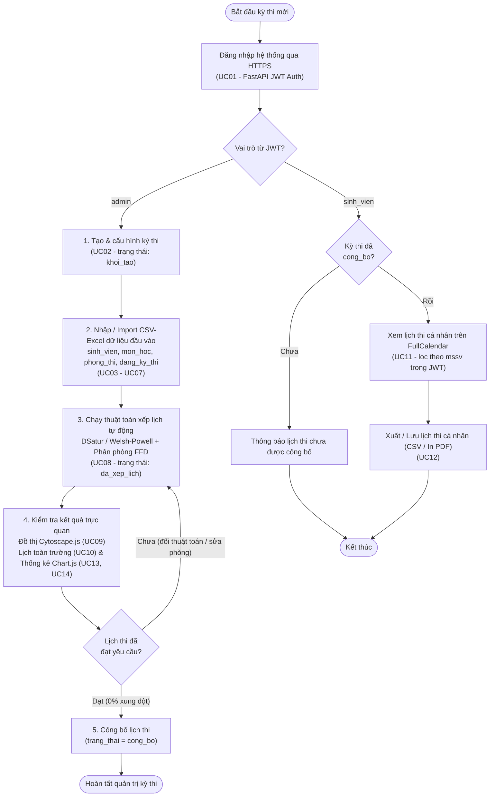
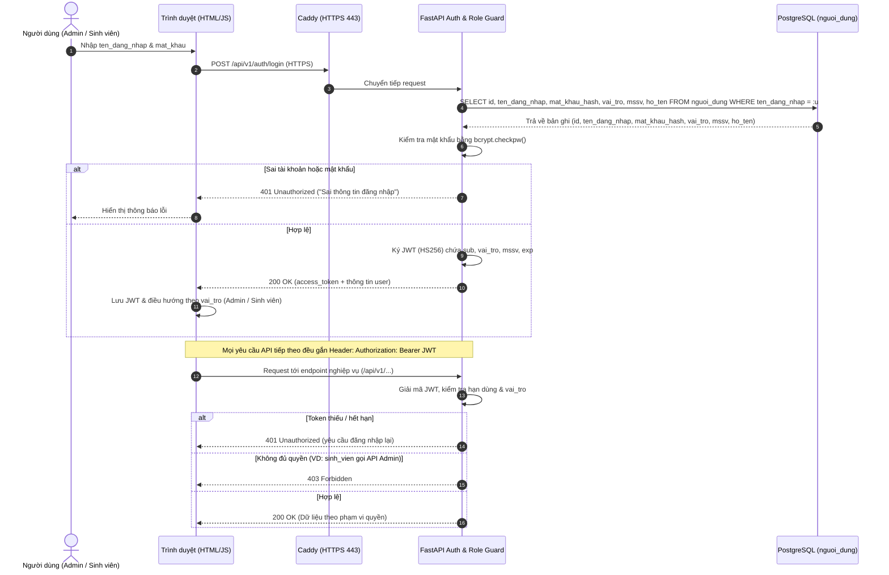
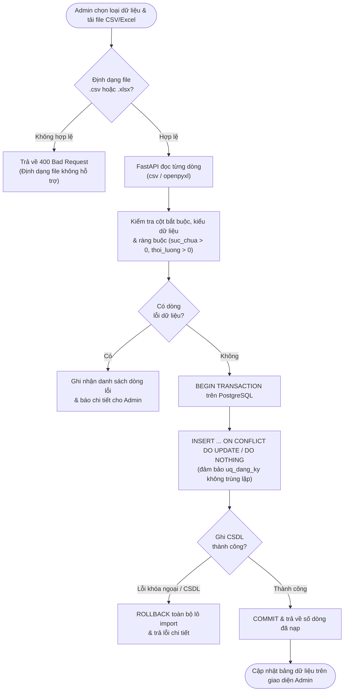
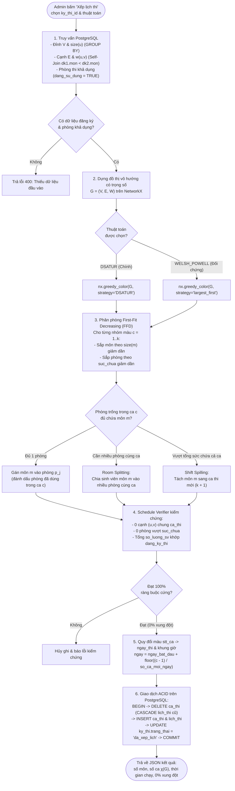
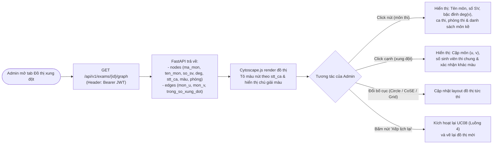
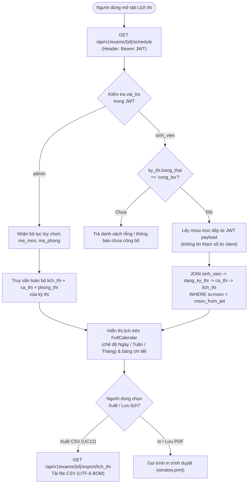
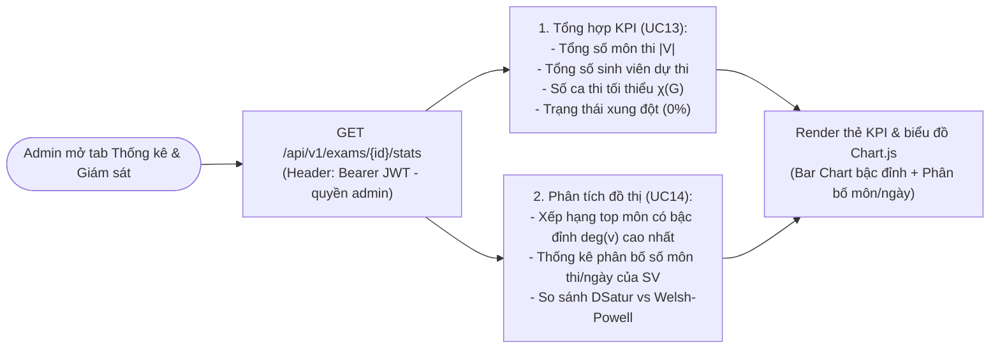

# Các sơ đồ luồng nghiệp vụ & xử lý (Flow Diagrams)

**Dự án:** Hệ thống xếp lịch thi tập trung bằng thuật toán tô màu đồ thị  

---

## 1. Luồng tổng quan nghiệp vụ hệ thống (End-to-End Workflow)

Sơ đồ mô tả toàn bộ vòng đời vận hành một kỳ thi từ lúc **Admin** khởi tạo dữ liệu cho tới khi **Sinh viên** nhận lịch thi cá nhân:

---

## 2. Luồng đăng nhập, xác thực JWT & phân quyền (`UC01`)

Hệ thống sử dụng **Native JWT (FastAPI + PyJWT + Bcrypt)** chạy qua cổng HTTPS của **Caddy**, không lưu session trên server:

---

## 3. Luồng quản lý dữ liệu & Import hàng loạt CSV/Excel (`UC02` – `UC07`)

Phục vụ Admin nạp nhanh danh sách sinh viên, học phần, phòng thi và đăng ký thi từ file `.csv` / `.xlsx`:

---

## 4. Luồng xếp lịch thi tự động: Tô màu đồ thị & Phân phòng FFD (`UC08`)

Đây là luồng xử lý cốt lõi kết nối **PostgreSQL**, **NetworkX** và giao dịch **ACID**:

---

## 5. Luồng trực quan hóa Đồ thị xung đột đã tô màu (`UC09`)

---

## 6. Luồng tra cứu & xuất lịch thi theo vai trò (`UC10`, `UC11`, `UC12`)

---

## 7. Luồng thống kê & phân tích đồ thị xung đột (`UC13`, `UC14`)

---

## 8. Bảng tổng hợp ánh xạ Sơ đồ luồng – Use Case

| Sơ đồ luồng | Phạm vi Use Case | Thành phần tham gia chính |
|---|---|---|
| **1. Luồng tổng quan nghiệp vụ** | Toàn bộ `UC01` – `UC14` | Admin, Sinh viên, Toàn hệ thống |
| **2. Luồng đăng nhập & phân quyền JWT** | `UC01` | Trình duyệt, Caddy, FastAPI Auth/Role Guard, `nguoi_dung` |
| **3. Luồng quản lý dữ liệu & Import CSV/Excel** | `UC02` – `UC07` | Admin, FastAPI (`csv`/`openpyxl`), PostgreSQL |
| **4. Luồng xếp lịch tự động & phân phòng FFD** | `UC08` (`UC08.1` – `UC08.4`) | Admin, FastAPI, NetworkX, PostgreSQL (ACID Transaction) |
| **5. Luồng trực quan hóa đồ thị xung đột** | `UC09` (mở rộng sang `UC08`) | Admin, `Cytoscape.js`, FastAPI |
| **6. Luồng tra cứu & xuất lịch thi** | `UC10`, `UC10.1`, `UC11`, `UC12` | Admin, Sinh viên, `FullCalendar`, FastAPI, PostgreSQL |
| **7. Luồng thống kê & phân tích đồ thị** | `UC13`, `UC14` | Admin, `Chart.js`, FastAPI, PostgreSQL |
