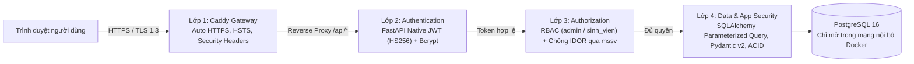

# Bảo mật & Phân quyền hệ thống (Security & Authorization)

**Dự án:** Hệ thống xếp lịch thi tập trung bằng thuật toán tô màu đồ thị

---

## 1. Kiến trúc bảo mật nhiều lớp (Defense in Depth)

Hệ thống áp dụng chiến lược **phòng thủ theo chiều sâu** gồm 4 lớp bảo vệ nối tiếp nhau từ trình duyệt đến cơ sở dữ liệu:



| Lớp | Công nghệ | Mục tiêu bảo vệ chính |
|---|---|---|
| **Lớp 1 — Truyền tải** | **Caddy 2 (Auto TLS)** | Mã hóa toàn bộ lưu lượng đăng nhập và JWT qua **HTTPS**; tự động chuyển hướng HTTP → HTTPS; không phơi bày cổng PostgreSQL ra ngoài Internet. |
| **Lớp 2 — Xác thực** | **FastAPI + PyJWT + Bcrypt** | Xác minh danh tính người dùng, băm mật khẩu một chiều có salt ngẫu nhiên, cấp JWT có chữ ký số và thời hạn ngắn. |
| **Lớp 3 — Phân quyền** | **FastAPI Role Guard (`Depends`)** | Kiểm soát quyền theo vai trò (`admin`, `sinh_vien`) và phạm vi sở hữu dữ liệu (`mssv` trích từ JWT). |
| **Lớp 4 — Ứng dụng & CSDL** | **SQLAlchemy ORM + Pydantic v2 + PostgreSQL** | Chống SQL Injection tuyệt đối bằng Parameterized Query, xác thực dữ liệu đầu vào nghiêm ngặt, chỉ truy vấn đúng cột cần thiết. |

---

## 2. Cơ chế xác thực (Authentication)

### 2.1. Băm mật khẩu bằng `bcrypt`
- Hệ thống **không bao giờ** lưu mật khẩu dạng bản rõ (*plaintext*) hay băm yếu (`MD5`, `SHA-1`).
- Khi tạo tài khoản hoặc import sinh viên, mật khẩu được băm bằng `bcrypt` với **salt ngẫu nhiên riêng cho từng tài khoản** (cost factor mặc định `12`) và lưu vào cột `nguoi_dung.mat_khau_hash`.
- Khi đăng nhập (`POST /api/v1/auth/login`), backend đối chiếu bằng `bcrypt.checkpw()` (so sánh thời gian hằng số để chống *timing attack*).
- Khi sai tên đăng nhập hoặc sai mật khẩu, API trả về cùng một thông báo chung `401 Unauthorized: "Sai tên đăng nhập hoặc mật khẩu"` để tránh kẻ tấn công dò xem tài khoản nào có tồn tại (*User Enumeration*).

### 2.2. Cấu trúc & Vòng đời JWT Token
Sau khi xác thực thành công, FastAPI phát hành **Access Token** chuẩn JWT ký bằng thuật toán `HS256` với khóa bí mật `JWT_SECRET` (nạp từ biến môi trường, độ dài tối thiểu 256-bit):

```json
{
  "sub": "20210001",
  "vai_tro": "sinh_vien",
  "mssv": "20210001",
  "ho_ten": "Nguyễn Văn An",
  "iat": 1763790000,
  "exp": 1763818800
}
```

- **`sub`:** `ten_dang_nhap` của người dùng.
- **`vai_tro`:** `'admin'` hoặc `'sinh_vien'`.
- **`mssv`:** mã số sinh viên (chỉ có khi `vai_tro = 'sinh_vien'`, bằng `null` với `admin`).
- **`exp`:** thời hạn token (khuyến nghị `2–4 giờ` cho môi trường thực tế), hết hạn sẽ trả `401 Unauthorized` và buộc đăng nhập lại.
- Mọi request tới API nghiệp vụ phải truyền qua header `Authorization: Bearer <access_token>`.

### 2.3. Cơ chế Đăng xuất (Logout) trong kiến trúc Stateless JWT
- **Bản chất Stateless:** Do backend không lưu phiên (session), tính hợp lệ của JWT được chứng thực bằng chữ ký mật mã. Do đó, việc đăng xuất được thực hiện chủ động từ phía trình duyệt.
- **Quy trình Đăng xuất tại Client:** Khi người dùng bấm **"Đăng xuất"** (`UC01`), script frontend lập tức xóa token khỏi `localStorage` / `sessionStorage`, xóa trạng thái người dùng trong bộ nhớ và điều hướng về màn hình đăng nhập.
- **Endpoint hỗ trợ:** Frontend có thể gọi `POST /api/v1/auth/logout` để ghi log sự kiện và xóa cookie (nếu triển khai token qua `Set-Cookie`).
- **Kiểm soát rủi ro:** Thời hạn sống của Access Token được cấu hình ngắn (`exp = 2–4 giờ`) để giảm thiểu cửa sổ tấn công nếu token bị lộ trước khi đăng xuất.

---

## 3. Phân quyền truy cập (Authorization — RBAC & Chống IDOR)

### 3.1. Cơ chế thực thi trong FastAPI
Hệ thống cài đặt 2 Dependency chuẩn cho toàn bộ route:
1. **`get_current_user`:** đọc Bearer Token, xác minh chữ ký `HS256` và hạn `exp`. Nếu thiếu hoặc sai → `401 Unauthorized`.
2. **`require_admin`:** kế thừa `get_current_user`, kiểm tra `vai_tro == "admin"`. Nếu không phải → `403 Forbidden`.

### 3.2. Nguyên tắc chống IDOR (Insecure Direct Object Reference) cho `sinh_vien`
- Khi sinh viên gọi API xem/xuất lịch thi cá nhân (`UC11`, `UC12`), hệ thống **tuyệt đối không** nhận `mssv` từ tham số URL (`?mssv=...`) hay body do trình duyệt gửi lên.
- Giá trị `:mssv` được lấy **duy nhất từ claim `mssv` đã được ký trong JWT payload** và đưa vào điều kiện `WHERE sv.mssv = :mssv_from_jwt`.
- Đồng thời chỉ trả dữ liệu cho `sinh_vien` khi kỳ thi ở trạng thái `trang_thai = 'cong_bo'`. Nhờ đó, một sinh viên không thể xem trộm lịch thi của sinh viên khác hoặc lịch thi nháp chưa công bố.

### 3.3. Ma trận phân quyền theo nhóm API Endpoint

| Nhóm chức năng | Endpoint tiêu biểu | Chưa đăng nhập | Sinh viên (`sinh_vien`) | Admin (`admin`) |
|---|---|---|---|---|
| **Xác thực (`UC01`)** | `POST /api/v1/auth/login` | Cho phép | Cho phép | Cho phép |
| | `GET /api/v1/auth/me` | `401` | Đọc thông tin bản thân | Đọc thông tin bản thân |
| **Quản lý Kỳ thi (`UC02`)** | `GET /api/v1/ky-thi` | `401` | Chỉ kỳ thi `cong_bo` | Toàn bộ kỳ thi |
| | `POST / PUT / DELETE /api/v1/ky-thi` | `401` | `403 Forbidden` | Toàn quyền |
| **Quản lý Danh mục (`UC03`–`UC06`)** | `CRUD /api/v1/sinh-vien`, `mon-hoc`, `phong-thi`, `dang-ky-thi` | `401` | `403 Forbidden` | Toàn quyền |
| **Import / Export (`UC07`)** | `POST /api/v1/import/{entity}` | `401` | `403 Forbidden` | Toàn quyền |
| | `GET /api/v1/export/{entity}` (danh mục) | `401` | `403 Forbidden` | Toàn quyền |
| **Xếp lịch tự động (`UC08`)** | `POST /api/v1/exams/{id}/schedule` | `401` | `403 Forbidden` | Toàn quyền |
| **Đồ thị xung đột (`UC09`)** | `GET /api/v1/exams/{id}/graph` | `401` | `403 Forbidden` | Toàn quyền |
| **Xem & Xuất lịch thi (`UC10`–`UC12`)** | `GET /api/v1/exams/{id}/schedule` | `401` | Chỉ môn mình ĐK (`cong_bo`) | Toàn trường + lọc môn/phòng |
| | `GET /api/v1/exams/{id}/export/lich_thi` | `401` | Chỉ xuất lịch cá nhân | Xuất lịch toàn trường |
| **Thống kê (`UC13`, `UC14`)** | `GET /api/v1/exams/{id}/stats` | `401` | `403 Forbidden` | Toàn quyền |

### 3.4. Ma trận phân quyền theo bảng dữ liệu (đồng bộ `04. Database design.md`)

| Bảng CSDL | Admin (`admin`) | Sinh viên (`sinh_vien`) |
|---|---|---|
| `nguoi_dung` | Toàn quyền | Chỉ đọc bản ghi của chính mình |
| `ky_thi`, `mon_hoc`, `phong_thi` | Toàn quyền (CRUD, import) | Chỉ đọc (khi kỳ thi đã `cong_bo`) |
| `sinh_vien`, `dang_ky_thi` | Toàn quyền (CRUD, import CSV/Excel) | Chỉ đọc bản ghi có `mssv` trùng JWT |
| `ca_thi`, `lich_thi` | Ghi (qua `UC08`), đọc toàn trường | Chỉ đọc lịch thi các môn bản thân đăng ký |

---

## 4. Phòng chống các lỗ hổng bảo mật phổ biến (OWASP Top 10)

| Mã OWASP / Nguy cơ | Biện pháp kỹ thuật áp dụng trong dự án |
|---|---|
| **A01 — Broken Access Control / IDOR** | Áp dụng `require_admin` cho mọi API quản trị & xếp lịch; sinh viên chỉ truy vấn theo `mssv` trích từ JWT, kiểm tra `ky_thi.trang_thai = 'cong_bo'`. |
| **A02 — Cryptographic Failures** | Bắt buộc HTTPS/TLS qua Caddy; băm mật khẩu bằng `bcrypt`; không trả cột `mat_khau_hash` trong bất kỳ response JSON nào. |
| **A03 — SQL Injection** | **Tuyệt đối không nối chuỗi SQL**; mọi truy vấn đi qua **SQLAlchemy ORM / Parameterized Query** (`WHERE ten_dang_nhap = $1`), liệt kê tường minh các cột cần `SELECT` (tránh `SELECT *`). |
| **A03 — XSS (Cross-Site Scripting)** | Giao diện Vanilla JS dùng `textContent` hoặc escape HTML khi hiển thị tên sinh viên/tên môn từ CSV/Excel, tránh chèn mã script qua `innerHTML`. |
| **A04 / Upload Abuse (Import CSV/Excel)** | Chỉ chấp nhận phần mở rộng `.csv`, `.xlsx`; giới hạn dung lượng file upload (VD: tối đa `5 MB`); kiểm tra kiểu dữ liệu từng dòng bằng Pydantic trước khi ghi vào PostgreSQL trong 1 transaction. |
| **A04 — CSV / Formula Injection** | Khi xử lý import/export file CSV/Excel, kiểm tra và vô hiệu hóa các ô văn bản bắt đầu bằng các ký tự công thức (`=`, `+`, `-`, `@`, `\t`, `\r`) bằng cách thêm tiền tố dấu nháy đơn (`'`), ngăn chặn trình bảng tính (Excel/Calc) tự động thực thi mã lệnh nguy hiểm khi mở file. |
| **A05 — Security Misconfiguration** | PostgreSQL & FastAPI chỉ bind loopback nội bộ (`127.0.0.1`); bật Security Headers trên Caddy (`Strict-Transport-Security`, `X-Content-Type-Options: nosniff`, `X-Frame-Options: DENY`, `Permissions-Policy`, xóa `Server`). |
| **A07 — Authentication & Client Guard** | Token có thời hạn `exp`; thông báo lỗi đăng nhập chung và không gợi ý độ dài tối thiểu mật khẩu; Route Guard phía Client (`enforceRouteGuard` trong `auth.js`) chỉ tin cậy `vai_tro` trích từ JWT payload, bỏ qua hoàn toàn mọi tham số URL (`?role=...`) và chống giả mạo `localStorage.current_user`. |
| **A08 — Software & Data Integrity (SRI)** | Toàn bộ thư viện CDN ghim phiên bản cố định (`FullCalendar 6.1.15`, `Cytoscape.js 3.30.4`, `Chart.js 4.4.7`) đều gắn mã băm **Subresource Integrity (`integrity="sha384-..." crossorigin="anonymous"`)**. *(Riêng `cdn.tailwindcss.com` dùng runtime JIT phục vụ phát triển nhanh không bundler; khi triển khai thực tế dài hạn khuyến nghị biên dịch CSS tĩnh cục bộ).* |

---

## 5. Quản lý bí mật & Cấu hình triển khai an toàn (Secrets Management)

1. **Kiểm chứng khóa bí mật tự động lúc khởi động (`Fail-Fast`):** Trong `backend/core/config.py`, `Settings` bắt buộc `JWT_SECRET` có độ dài tối thiểu **32 bytes (256-bit)** trên mọi môi trường (loại bỏ cảnh báo `InsecureKeyLengthWarning` của `PyJWT`), đồng thời **từ chối khởi động ngay lập tức** nếu `APP_ENV=production` mà vẫn dùng `JWT_SECRET` mặc định của môi trường dev/example.
2. **Không hardcode khóa bí mật trong mã nguồn:** Các giá trị `APP_ENV`, `JWT_SECRET`, `POSTGRES_USER`, `POSTGRES_PASSWORD`, `POSTGRES_DB` được đọc từ file `.env` (chỉ commit `.env.example`, đưa `.env` vào `.gitignore`).
3. **Đổi thông tin mặc định trước khi triển khai thật:** Tài khoản khởi tạo `admin / admin123` trong `init.sql` và `sv01 / student123` trong `scripts/seed.py` chỉ dùng cho môi trường phát triển/demo; khi chạy thực tế phải đặt `APP_ENV=production`, đổi `JWT_SECRET` ngẫu nhiên mạnh và cập nhật mật khẩu quản trị.
4. **Bảo vệ kết nối mạng nội bộ:** Chỉ mở cổng `80`/`443` của container `caddy` ra bên ngoài; `fastapi` và `postgres` giao tiếp qua mạng nội bộ Docker.
