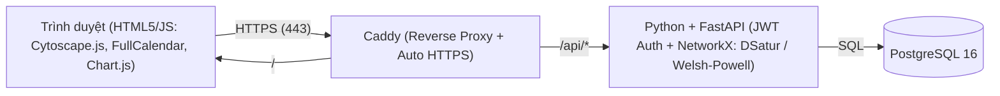

# Công nghệ sử dụng (Technology Stack)

Tài liệu mô tả chi tiết các công nghệ, thư viện và công cụ hạ tầng được lựa chọn cho hệ thống **Xếp lịch thi tập trung bằng thuật toán tô màu đồ thị**, tương ứng với các chức năng tại [01. Product features.md](./01.%20Product%20features.md) và [02. Use case diagram.md](./02.%20Use%20case%20diagram.md).

---

## 1. Sơ đồ tổng quan công nghệ

Toàn bộ hệ thống được đóng gói gọn trong **3 service Docker**: `caddy`, `fastapi`, `postgres`.

---

## 2. Bảng tổng hợp công nghệ theo tầng

| Tầng | Công nghệ / Thư viện | Vai trò trong dự án | Ánh xạ chức năng |
|---|---|---|---|
| **Frontend** | HTML5, CSS3, Vanilla JS (ES6+) | Giao diện web tĩnh gọn nhẹ, không cần bước build | 2.1, 2.2, 2.4, 2.5 |
| | **Cytoscape.js** | Vẽ và tương tác đồ thị xung đột đã tô màu (nút, cạnh, bậc đỉnh, số SV chung) | 2.4 (`UC09`) |
| | **FullCalendar** | Hiển thị lịch thi dạng ngày/tuần/tháng cho admin và sinh viên | 2.4 (`UC10`, `UC11`) |
| | **Chart.js** | Vẽ biểu đồ thống kê tổng quan kỳ thi và phân tích đồ thị xung đột | 2.5 (`UC13`, `UC14`) |
| **Backend, Xác thực & Thuật toán** | **Python 3.11+ & FastAPI** | Xây dựng REST API đăng nhập, CRUD, import/export CSV–Excel, tổng hợp thống kê và chạy xếp lịch | 2.1 – 2.5 |
| | **PyJWT & bcrypt** | Băm mật khẩu người dùng, phát hành và xác thực JWT token (`HS256`) chứa role (`admin`, `sinh_vien`) và `mssv` | 2.1 (`UC01`) |
| | **NetworkX** | Xây dựng đồ thị xung đột $G=(V,E)$ và chạy thuật toán tô màu **DSatur**, **Welsh–Powell** | 2.3 (`UC08`) |
| | **Uvicorn** | ASGI server hiệu năng cao để chạy ứng dụng FastAPI | 2.1 – 2.5 |
| | **psycopg / SQLAlchemy** | Kết nối và thao tác dữ liệu với PostgreSQL | 2.1 – 2.5 |
| | **csv / openpyxl** | Đọc và xuất dữ liệu hàng loạt định dạng CSV / Excel | 2.2 (`UC07`), 2.4 (`UC12`) |
| **Cơ sở dữ liệu** | **PostgreSQL 16** | Lưu trữ tài khoản, dữ liệu kỳ thi, sinh viên, môn học, đăng ký thi, phòng thi, ca thi và lịch thi | 2.1 – 2.5 |
| **Reverse Proxy & HTTPS** | **Caddy** | Cổng vào duy nhất, phục vụ giao diện web tĩnh, định tuyến `/api` và tự động cấp/gia hạn chứng chỉ HTTPS (TLS) | Toàn hệ thống |
| **Triển khai** | **Docker & Docker Compose** | Đóng gói và khởi chạy đồng bộ toàn bộ 3 service bằng một lệnh | Triển khai |

---

## 3. Chi tiết và lý do lựa chọn

### 3.1. Python + FastAPI + NetworkX + JWT Auth
- **FastAPI:** cú pháp gọn, kiểm tra dữ liệu đầu vào tự động bằng Pydantic, hỗ trợ sẵn `OAuth2PasswordBearer` và tự sinh tài liệu OpenAPI (`/docs`) giúp kiểm thử API nhanh.
- **FastAPI JWT Auth (`PyJWT` + `bcrypt`):** xác thực trực tiếp trong backend mà không cần triển khai thêm máy chủ IAM ngoài. Mật khẩu được băm bằng `bcrypt`, token JWT (`HS256`) mang thông tin vai trò (`admin`, `sinh_vien`) và `mssv` giúp kiểm tra quyền truy cập stateless, nhẹ RAM và không phụ thuộc dịch vụ bên thứ ba.
- **NetworkX:** thư viện đồ thị tiêu chuẩn trong Python, hỗ trợ sẵn thuật toán tô màu **DSatur** (`nx.greedy_color(G, strategy="DSATUR")`) và **Welsh–Powell** (`strategy="largest_first"`), cho phép dựng đồ thị $G=(V,E)$, tính bậc đỉnh, trọng số cạnh và kiểm chứng 0 xung đột chỉ trong vài chục dòng mã.

### 3.2. PostgreSQL 16
- Hệ quản trị CSDL quan hệ mã nguồn mở mạnh mẽ, đảm bảo toàn vẹn khóa ngoại giữa các bảng `users`, `ky_thi`, `sinh_vien`, `mon_hoc`, `dang_ky`, `phong`, `ca_thi`, `lich_thi`.
- Hỗ trợ truy vấn tổng hợp (GROUP BY, JOIN, self-join tìm cặp môn xung đột) nhanh và chính xác.

### 3.3. HTML/JS thuần kết hợp Cytoscape.js, FullCalendar, Chart.js
- **Không dùng framework SPA phức tạp (React/Angular/TypeScript):** dự án chỉ gồm các màn hình tập trung vào nghiệp vụ xếp lịch, lịch thi và đồ thị; dùng HTML/JS thuần nạp thư viện qua CDN giúp loại bỏ hoàn toàn bước build (`node_modules`, bundler) và dễ bảo trì.
- **Cytoscape.js:** chuyên dụng cho trực quan hóa đồ thị có đỉnh/cạnh, hỗ trợ tô màu nút theo ca thi, phóng to/thu nhỏ, kéo thả đỉnh và bắt sự kiện click để xem bậc đỉnh / số sinh viên trùng.
- **FullCalendar:** hiển thị lịch thi trực quan theo ngày/tuần/tháng, dễ lọc theo môn học hoặc phòng thi và hỗ trợ xuất lịch cá nhân.
- **Chart.js:** thư viện vẽ biểu đồ nhẹ, đáp ứng đầy đủ nhu cầu thống kê tổng quan kỳ thi và phân tích top môn bậc cao ở mục 2.5.

### 3.4. Caddy
- Cấu hình cực ngắn (~15 dòng trong `Caddyfile`) so với Nginx.
- **Tự động bật HTTPS (Auto TLS):** tự sinh chứng chỉ nội bộ tin cậy khi chạy local (`localhost`) và tự lấy/gia hạn chứng chỉ Let's Encrypt khi triển khai trên tên miền thật — đảm bảo toàn bộ lưu lượng đăng nhập và API được mã hóa.
- Phục vụ trực tiếp thư mục file tĩnh HTML/JS mà không cần thêm web server riêng.

### 3.5. Docker & Docker Compose
- Đảm bảo môi trường chạy đồng nhất trên mọi máy (Linux, Windows, macOS).
- Khởi chạy toàn bộ hệ thống (`postgres`, `fastapi`, `caddy`) chỉ với `docker compose up -d`.

---

## 4. Ghi chú về thiết kế tinh gọn

Kiến trúc được tối giản xuống **3 service** (`caddy`, `fastapi`, `postgres`) nhằm khởi động nhanh, tiết kiệm tài nguyên (chỉ tốn ~150–250MB RAM) và tập trung trọng tâm vào thuật toán tô màu đồ thị:
- **Dùng FastAPI JWT Auth thay cho Keycloak:** giảm ~700MB RAM và loại bỏ độ phức tạp khi cấu hình realm/OIDC redirect URI.
- **Gộp API CRUD và import CSV/Excel vào FastAPI:** không cần chạy thêm PostgREST và NocoDB.
- **Dùng Chart.js thay cho Grafana:** hiển thị thống kê trực tiếp ngay trên giao diện quản trị web.
