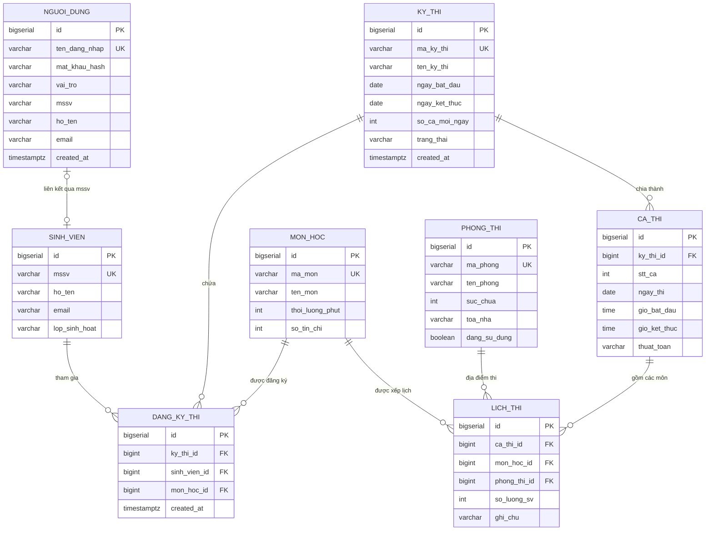
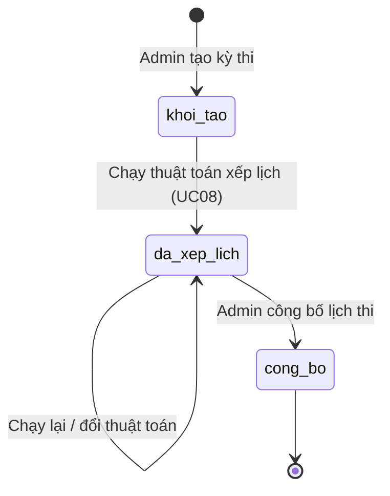
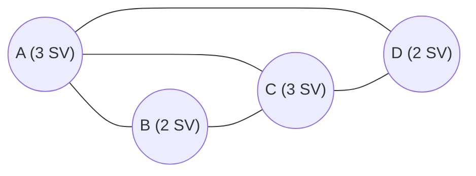
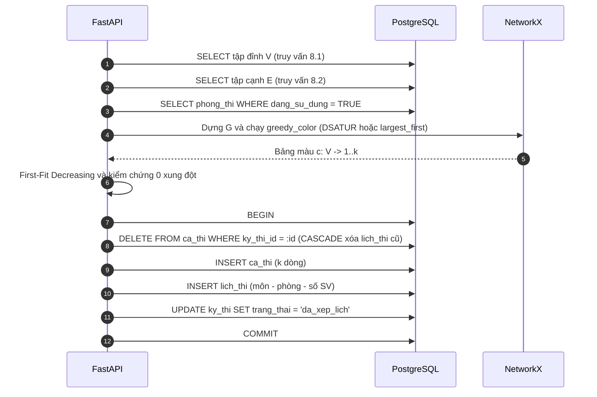

# CHƯƠNG: THIẾT KẾ CƠ SỞ DỮ LIỆU

> **Đề tài:** Hệ thống xếp lịch thi tập trung bằng thuật toán tô màu đồ thị
> **Nguồn tham chiếu:** `docs/` trong repo [phattvh/GraphTheory_HTTPS](https://github.com/phattvh/GraphTheory_HTTPS/tree/main/docs) – chủ yếu là `04. Database design.md`, cùng với `01. Product features.md`, `02. Use case diagram.md`, `03. Architecture and algorithms.md` và `10. Technology stack.md`.
> Những chỗ đánh dấu **[ĐỀ XUẤT]** là phần bổ sung, không có trong tài liệu gốc. Những chỗ đánh dấu **[CẦN THỐNG NHẤT]** là chỗ tài liệu gốc ghi chưa khớp nhau (xem tổng hợp ở **Phụ lục A**).

---

## 1. Giới thiệu

Cơ sở dữ liệu (CSDL) là tầng lưu trữ (*Persistence Layer*) của hệ thống, chạy trên **PostgreSQL 16** trong một container Docker (service `postgres`). Tầng nghiệp vụ **FastAPI** kết nối tới CSDL qua **SQLAlchemy / psycopg**. CSDL làm ba việc:

1. **Lưu dữ liệu danh mục và dữ liệu đầu vào:** tài khoản người dùng, kỳ thi, môn học, sinh viên, phòng thi và danh sách đăng ký thi.
2. **Cung cấp dữ liệu để dựng đồ thị xung đột** $G = (V, E)$: từ bảng đăng ký thi, CSDL dùng truy vấn tổng hợp (GROUP BY, Self-Join) để lấy ra tập đỉnh, tập cạnh và trọng số.
3. **Lưu kết quả xếp lịch:** các ca thi (tương ứng với các *màu* do thuật toán DSatur/Welsh–Powell gán) và lịch thi chi tiết theo phòng.

### 1.1. Nguyên tắc thiết kế

| Nguyên tắc | Nội dung |
|---|---|
| **Chuẩn hóa 3NF** | Giữ dữ liệu toàn vẹn, không dư thừa và nhất quán khi cập nhật. |
| **Quy ước đặt tên** | Tên bảng và tên cột viết thường theo kiểu `snake_case`, dùng tiếng Việt không dấu (`sinh_vien`, `dang_ky_thi`, …). |
| **Khóa chính thay thế** | Mọi bảng dùng `id BIGSERIAL` làm khóa chính. Các mã nghiệp vụ (`mssv`, `ma_mon`, `ma_phong`, `ma_ky_thi`) có ràng buộc `UNIQUE`. |
| **Tối ưu cho bài toán đồ thị** | Đặt chỉ mục chuyên biệt trên bảng `dang_ky_thi` để truy vấn Self-Join tìm cặp môn xung đột chỉ mất vài mili-giây. |
| **Tính toàn vẹn ACID** | Dùng khóa ngoại (`FOREIGN KEY`), `CHECK`, `UNIQUE` và giao dịch (transaction) của PostgreSQL. |

---

## 2. Phân tích yêu cầu dữ liệu

Dựa trên các nhóm chức năng (tài liệu `01`) và use case (tài liệu `02`), hệ thống cần lưu các nhóm dữ liệu sau:

| Nhóm chức năng | Use case liên quan | Dữ liệu cần lưu | Bảng |
|---|---|---|---|
| Đăng nhập & phân quyền | UC01 | Tên đăng nhập, mật khẩu băm (bcrypt), vai trò, MSSV | `nguoi_dung` |
| Quản lý kỳ thi | UC02 | Mã/tên kỳ thi, ngày bắt đầu/kết thúc, số ca mỗi ngày, trạng thái | `ky_thi` |
| Quản lý sinh viên | UC03 | MSSV, họ tên, email, lớp sinh hoạt | `sinh_vien` |
| Quản lý môn thi | UC04 | Mã môn, tên môn, thời lượng thi, số tín chỉ | `mon_hoc` |
| Quản lý đăng ký thi | UC05, UC07 | Sinh viên *s* thi môn *m* trong kỳ thi *k* | `dang_ky_thi` |
| Quản lý phòng thi | UC06 | Mã phòng, sức chứa, tòa nhà, trạng thái sử dụng | `phong_thi` |
| Xếp lịch thi (tô màu) | UC08 | Ca thi (màu), ngày giờ, thuật toán đã dùng | `ca_thi` |
| Phân phòng & lịch thi | UC08 – UC12 | Môn – ca – phòng – số lượng SV | `lich_thi` |

Tổng cộng có **8 bảng**, chia thành 3 nhóm:

- **Nhóm xác thực:** `nguoi_dung`
- **Nhóm danh mục & đầu vào:** `ky_thi`, `mon_hoc`, `sinh_vien`, `phong_thi`, `dang_ky_thi`
- **Nhóm kết quả xếp lịch:** `ca_thi`, `lich_thi`

---

## 3. Mô hình dữ liệu mức khái niệm (ERD)

### 3.1. Sơ đồ thực thể – liên kết



> [!NOTE]
> ERD trong tài liệu gốc vẽ quan hệ `NGUOI_DUNG ||--o{ SINH_VIEN` (1–N). Theo ngữ nghĩa thì **một sinh viên có tối đa một tài khoản** và tài khoản `admin` không gắn với sinh viên nào, nên bản nháp này vẽ lại thành quan hệ **0..1 – 0..1** **[CẦN THỐNG NHẤT]**.

### 3.2. Mô tả các mối liên kết

| Liên kết | Bản số | Ý nghĩa |
|---|---|---|
| `nguoi_dung` – `sinh_vien` | 0..1 : 0..1 | Tài khoản có vai trò `sinh_vien` liên kết với đúng một hồ sơ sinh viên qua `mssv`. Tài khoản `admin` không liên kết. |
| `ky_thi` – `dang_ky_thi` | 1 : N | Một kỳ thi có nhiều bản ghi đăng ký. |
| `sinh_vien` – `dang_ky_thi` – `mon_hoc` | N : M (qua bảng trung gian) | Một sinh viên thi nhiều môn, một môn có nhiều sinh viên thi, xét trong từng kỳ thi. |
| `ky_thi` – `ca_thi` | 1 : N | Một kỳ thi được chia thành *k* ca thi (*k* là số màu tìm được). |
| `ca_thi` – `lich_thi` | 1 : N | Một ca thi có nhiều môn thi diễn ra đồng thời ở nhiều phòng. |
| `mon_hoc` – `lich_thi` | 1 : N | Một môn có thể được chia ra nhiều phòng (*Room Splitting*). |
| `phong_thi` – `lich_thi` | 1 : N | Một phòng được dùng ở nhiều ca thi khác nhau. |

### 3.3. Ánh xạ giữa mô hình đồ thị và CSDL

Đây là điểm cốt lõi của thiết kế: đồ thị xung đột **không được lưu cố định** trong CSDL mà được **suy ra lúc chạy** từ bảng `dang_ky_thi`.

| Khái niệm toán học | Biểu diễn trong CSDL |
|---|---|
| Tập môn thi $M$, tập đỉnh $V$ | Các `mon_hoc_id` khác nhau trong `dang_ky_thi` của kỳ thi đang xét |
| Tập sinh viên $S$ | Các `sinh_vien_id` khác nhau trong `dang_ky_thi` |
| Quan hệ đăng ký $R \subseteq S \times M$ | Mỗi dòng của `dang_ky_thi` (với cùng `ky_thi_id`) |
| Trọng số đỉnh $\text{size}(u)$ | `COUNT(sinh_vien_id)` theo `mon_hoc_id` |
| Cạnh $(u, v) \in E$ và trọng số $w(u,v)$ | Self-Join `dang_ky_thi` theo `sinh_vien_id`, đếm số sinh viên chung |
| Màu $c(v) \in \{1..k\}$ | `ca_thi.stt_ca` |
| Tập phòng $P$, sức chứa $\text{cap}(p)$ | `phong_thi` với `dang_su_dung = TRUE`, cột `suc_chua` |
| Kết quả phân phòng (Bin Packing – FFD) | `lich_thi` (`ca_thi_id`, `mon_hoc_id`, `phong_thi_id`, `so_luong_sv`) |

---

## 4. Mô hình dữ liệu mức logic (lược đồ quan hệ)

Ký hiệu: khóa chính được **in đậm**, khóa ngoại in *nghiêng*, (UK) là cột có ràng buộc duy nhất.

- **nguoi_dung**(**id**, ten_dang_nhap (UK), mat_khau_hash, vai_tro, *mssv*, ho_ten, email, created_at)
- **ky_thi**(**id**, ma_ky_thi (UK), ten_ky_thi, ngay_bat_dau, ngay_ket_thuc, so_ca_moi_ngay, trang_thai, created_at)
- **mon_hoc**(**id**, ma_mon (UK), ten_mon, thoi_luong_phut, so_tin_chi)
- **sinh_vien**(**id**, mssv (UK), ho_ten, email, lop_sinh_hoat)
- **dang_ky_thi**(**id**, *ky_thi_id*, *sinh_vien_id*, *mon_hoc_id*, created_at), với UK(ky_thi_id, sinh_vien_id, mon_hoc_id)
- **phong_thi**(**id**, ma_phong (UK), ten_phong, suc_chua, toa_nha, dang_su_dung)
- **ca_thi**(**id**, *ky_thi_id*, stt_ca, ngay_thi, gio_bat_dau, gio_ket_thuc, thuat_toan)
- **lich_thi**(**id**, *ca_thi_id*, *mon_hoc_id*, *phong_thi_id*, so_luong_sv, ghi_chu)

### 4.1. Đánh giá chuẩn hóa

- **1NF:** Mọi thuộc tính đều nguyên tố, không có nhóm lặp. Ví dụ: danh sách môn của một sinh viên được tách thành nhiều dòng trong `dang_ky_thi` thay vì lưu chung một cột.
- **2NF:** Mọi bảng dùng khóa chính đơn (`id`), nên không có phụ thuộc bộ phận.
- **3NF:** Các thuộc tính không khóa chỉ phụ thuộc trực tiếp vào khóa. Thông tin sinh viên và môn học không bị chép lại vào `dang_ky_thi` hay `lich_thi` mà được tham chiếu qua khóa ngoại.
- **Dữ liệu suy diễn có chủ đích:**
  - `lich_thi.so_luong_sv` là kết quả phân phòng. Khi một môn bị chia ra nhiều phòng, số này **không** suy ra được trực tiếp từ `dang_ky_thi`, nên cần lưu lại.
  - `ca_thi.thuat_toan` thực chất phụ thuộc vào *lần chạy xếp lịch* của kỳ thi chứ không phụ thuộc vào từng ca, nên bị lặp lại ở mọi ca của cùng kỳ thi. Có thể chấp nhận vì mỗi lần xếp lịch sẽ ghi đè toàn bộ các ca **[CẦN THỐNG NHẤT]**.

---

## 5. Từ điển dữ liệu (Data Dictionary)

### 5.1. Bảng `nguoi_dung` – Tài khoản & phân quyền

Lưu thông tin xác thực cho cơ chế FastAPI Native JWT (PyJWT + bcrypt, `HS256`).

| Tên cột | Kiểu dữ liệu | Ràng buộc | Mô tả |
|---|---|---|---|
| `id` | `BIGSERIAL` | `PRIMARY KEY` | Khóa chính tự tăng |
| `ten_dang_nhap` | `VARCHAR(50)` | `NOT NULL, UNIQUE` | Tên đăng nhập (`admin` hoặc MSSV) |
| `mat_khau_hash` | `VARCHAR(255)` | `NOT NULL` | Chuỗi băm mật khẩu bằng `bcrypt` |
| `vai_tro` | `VARCHAR(20)` | `NOT NULL, CHECK (vai_tro IN ('admin','sinh_vien'))` | Vai trò, được ký vào JWT payload |
| `mssv` | `VARCHAR(20)` | `NULL, REFERENCES sinh_vien(mssv)` | Liên kết hồ sơ sinh viên khi `vai_tro = 'sinh_vien'` |
| `ho_ten` | `VARCHAR(100)` | `NOT NULL` | Họ và tên |
| `email` | `VARCHAR(100)` | `NULL` | Email liên lạc |
| `created_at` | `TIMESTAMPTZ` | `DEFAULT CURRENT_TIMESTAMP` | Thời điểm tạo tài khoản |

### 5.2. Bảng `ky_thi` – Kỳ thi

| Tên cột | Kiểu dữ liệu | Ràng buộc | Mô tả |
|---|---|---|---|
| `id` | `BIGSERIAL` | `PRIMARY KEY` | Khóa chính |
| `ma_ky_thi` | `VARCHAR(50)` | `NOT NULL, UNIQUE` | Mã kỳ thi (VD: `KTHK1_2026`) |
| `ten_ky_thi` | `VARCHAR(255)` | `NOT NULL` | Tên đầy đủ |
| `ngay_bat_dau` | `DATE` | `NOT NULL` | Ngày bắt đầu |
| `ngay_ket_thuc` | `DATE` | `NOT NULL`, `>= ngay_bat_dau` | Ngày kết thúc |
| `so_ca_moi_ngay` | `INT` | `NOT NULL, DEFAULT 4` | Số ca thi tối đa mỗi ngày (thường 3–4) |
| `trang_thai` | `VARCHAR(20)` | `DEFAULT 'khoi_tao'`, `CHECK IN ('khoi_tao','da_xep_lich','cong_bo')` | Trạng thái vòng đời kỳ thi |
| `created_at` | `TIMESTAMPTZ` | `DEFAULT CURRENT_TIMESTAMP` | Thời điểm tạo |

**Vòng đời trạng thái kỳ thi:**



> [!NOTE]
> Trong tài liệu gốc, ERD dùng giá trị `hoan_tat`, còn từ điển dữ liệu và script SQL dùng `cong_bo`. Bản nháp này theo **script SQL** (`cong_bo`) **[CẦN THỐNG NHẤT]**.

### 5.3. Bảng `mon_hoc` – Danh mục môn thi

| Tên cột | Kiểu dữ liệu | Ràng buộc | Mô tả |
|---|---|---|---|
| `id` | `BIGSERIAL` | `PRIMARY KEY` | Khóa chính |
| `ma_mon` | `VARCHAR(20)` | `NOT NULL, UNIQUE` | Mã môn học (VD: `TTH101`, `CS201`) |
| `ten_mon` | `VARCHAR(255)` | `NOT NULL` | Tên môn học |
| `thoi_luong_phut` | `INT` | `NOT NULL, DEFAULT 90` | Thời gian làm bài (phút) |
| `so_tin_chi` | `INT` | `DEFAULT 3` | Số tín chỉ |

### 5.4. Bảng `sinh_vien` – Danh sách sinh viên

| Tên cột | Kiểu dữ liệu | Ràng buộc | Mô tả |
|---|---|---|---|
| `id` | `BIGSERIAL` | `PRIMARY KEY` | Khóa chính |
| `mssv` | `VARCHAR(20)` | `NOT NULL, UNIQUE` | Mã số sinh viên |
| `ho_ten` | `VARCHAR(100)` | `NOT NULL` | Họ và tên |
| `email` | `VARCHAR(100)` | `NULL` | Email |
| `lop_sinh_hoat` | `VARCHAR(50)` | `NULL` | Lớp sinh hoạt |

### 5.5. Bảng `dang_ky_thi` – Đăng ký thi (đầu vào dựng đồ thị)

Đây là **bảng quan trọng nhất** của hệ thống. Nó biểu diễn quan hệ N–M giữa sinh viên và môn thi trong từng kỳ thi, tức là quan hệ $R$ trong mô hình toán học.

| Tên cột | Kiểu dữ liệu | Ràng buộc | Mô tả |
|---|---|---|---|
| `id` | `BIGSERIAL` | `PRIMARY KEY` | Khóa chính |
| `ky_thi_id` | `BIGINT` | `NOT NULL, FK → ky_thi(id) ON DELETE CASCADE` | Kỳ thi |
| `sinh_vien_id` | `BIGINT` | `NOT NULL, FK → sinh_vien(id) ON DELETE CASCADE` | Sinh viên dự thi |
| `mon_hoc_id` | `BIGINT` | `NOT NULL, FK → mon_hoc(id) ON DELETE CASCADE` | Môn đăng ký thi |
| `created_at` | `TIMESTAMPTZ` | `DEFAULT CURRENT_TIMESTAMP` | Thời điểm ghi nhận |

> [!IMPORTANT]
> Ràng buộc `UNIQUE (ky_thi_id, sinh_vien_id, mon_hoc_id)` (tên `uq_dang_ky`) là bắt buộc. Nó ngăn một sinh viên đăng ký cùng một môn hai lần trong một kỳ thi, nhờ đó trọng số cạnh không bị đếm sai.

### 5.6. Bảng `phong_thi` – Danh mục phòng thi

| Tên cột | Kiểu dữ liệu | Ràng buộc | Mô tả |
|---|---|---|---|
| `id` | `BIGSERIAL` | `PRIMARY KEY` | Khóa chính |
| `ma_phong` | `VARCHAR(50)` | `NOT NULL, UNIQUE` | Mã phòng (VD: `A2-101`) |
| `ten_phong` | `VARCHAR(100)` | `NOT NULL` | Tên phòng |
| `suc_chua` | `INT` | `NOT NULL, CHECK (suc_chua > 0)` | Sức chứa tối đa, tức $\text{cap}(p)$ |
| `toa_nha` | `VARCHAR(50)` | `NULL` | Tòa nhà / khu vực |
| `dang_su_dung` | `BOOLEAN` | `DEFAULT TRUE` | Phòng có được dùng để thi hay không |

### 5.7. Bảng `ca_thi` – Ca thi (màu của đồ thị)

Mỗi dòng ứng với **một màu** mà thuật toán tô màu gán cho kỳ thi.

| Tên cột | Kiểu dữ liệu | Ràng buộc | Mô tả |
|---|---|---|---|
| `id` | `BIGSERIAL` | `PRIMARY KEY` | Khóa chính |
| `ky_thi_id` | `BIGINT` | `NOT NULL, FK → ky_thi(id) ON DELETE CASCADE` | Kỳ thi |
| `stt_ca` | `INT` | `NOT NULL` | Số thứ tự ca, chính là màu 1, 2, …, *k* |
| `ngay_thi` | `DATE` | `NOT NULL` | Ngày thi |
| `gio_bat_dau` | `TIME` | `NOT NULL` | Giờ bắt đầu (VD: `07:30:00`) |
| `gio_ket_thuc` | `TIME` | `NOT NULL` | Giờ kết thúc (VD: `09:30:00`) |
| `thuat_toan` | `VARCHAR(30)` | `DEFAULT 'DSATUR'` | Thuật toán đã dùng: `DSATUR` hoặc `WELSH_POWELL` |

**Quy tắc đổi màu sang ngày/giờ:** với `so_ca_moi_ngay` = *n*, ca thứ `stt_ca` = *c* được xếp vào ngày `ngay_bat_dau + ⌊(c − 1) / n⌋` và là khung giờ thứ `((c − 1) mod n) + 1` trong ngày đó **[ĐỀ XUẤT – tài liệu gốc chưa mô tả cách đổi]**.

### 5.8. Bảng `lich_thi` – Lịch thi chi tiết & phân phòng

Lưu kết quả cuối cùng của thuật toán phân phòng First-Fit Decreasing.

| Tên cột | Kiểu dữ liệu | Ràng buộc | Mô tả |
|---|---|---|---|
| `id` | `BIGSERIAL` | `PRIMARY KEY` | Khóa chính |
| `ca_thi_id` | `BIGINT` | `NOT NULL, FK → ca_thi(id) ON DELETE CASCADE` | Ca thi |
| `mon_hoc_id` | `BIGINT` | `NOT NULL, FK → mon_hoc(id) ON DELETE CASCADE` | Môn thi |
| `phong_thi_id` | `BIGINT` | `NOT NULL, FK → phong_thi(id) ON DELETE RESTRICT` | Phòng thi |
| `so_luong_sv` | `INT` | `NOT NULL, CHECK (so_luong_sv > 0)` | Số sinh viên thi tại phòng này |
| `ghi_chu` | `VARCHAR(255)` | `NULL` | Ghi chú (VD: "Phòng chính", "Nhóm 2") |

> [!NOTE]
> Khóa ngoại tới `phong_thi` dùng `ON DELETE RESTRICT` để **không xóa được phòng đã có lịch thi**. Muốn ngừng dùng phòng thì đặt `dang_su_dung = FALSE`.

---

## 6. Ràng buộc toàn vẹn

### 6.1. Ràng buộc đã có trong thiết kế gốc

| Loại | Ràng buộc | Mục đích |
|---|---|---|
| Khóa chính | `id BIGSERIAL` ở mọi bảng | Định danh duy nhất |
| Duy nhất | `ten_dang_nhap`, `ma_ky_thi`, `ma_mon`, `mssv`, `ma_phong` | Mã nghiệp vụ không trùng |
| Duy nhất (tổ hợp) | `uq_dang_ky (ky_thi_id, sinh_vien_id, mon_hoc_id)` | Không đăng ký trùng |
| Miền giá trị | `vai_tro IN ('admin','sinh_vien')` | Chỉ có 2 vai trò |
| Miền giá trị | `trang_thai IN ('khoi_tao','da_xep_lich','cong_bo')` | Trạng thái kỳ thi hợp lệ |
| Miền giá trị | `suc_chua > 0`, `so_luong_sv > 0` | Số lượng dương |
| Tham chiếu | `ON DELETE CASCADE` cho `dang_ky_thi`, `ca_thi`, `lich_thi` | Xóa kỳ thi thì dọn sạch dữ liệu con |
| Tham chiếu | `ON DELETE RESTRICT` cho `lich_thi.phong_thi_id` | Bảo vệ phòng đang có lịch |

### 6.2. Ràng buộc nghiệp vụ (kiểm tra ở tầng ứng dụng)

Những ràng buộc sau liên quan đến nhiều dòng hoặc nhiều bảng nên được **FastAPI (module Schedule Verifier)** kiểm tra trước khi ghi:

1. **Ràng buộc cứng 1 – Không trùng lịch:** với mọi cạnh $(u,v) \in E$ thì $c(u) \ne c(v)$. Nghĩa là không có sinh viên nào thi hai môn trong cùng một `ca_thi`.
2. **Ràng buộc cứng 2 – Sức chứa:** tổng `so_luong_sv` của các môn trong cùng ca không vượt quá tổng `suc_chua` của các phòng `dang_su_dung = TRUE`.
3. **Đủ sinh viên:** với mỗi môn, tổng `lich_thi.so_luong_sv` trên các phòng phải bằng số sinh viên đăng ký môn đó.
4. **Mỗi phòng không quá sức chứa:** `lich_thi.so_luong_sv ≤ phong_thi.suc_chua`.

### 6.3. Ràng buộc bổ sung **[ĐỀ XUẤT]**

```sql
-- Ngày kết thúc phải sau hoặc bằng ngày bắt đầu (từ điển gốc có nêu nhưng script chưa cài)
ALTER TABLE ky_thi  ADD CONSTRAINT ck_ky_thi_ngay  CHECK (ngay_ket_thuc >= ngay_bat_dau);
ALTER TABLE ky_thi  ADD CONSTRAINT ck_so_ca        CHECK (so_ca_moi_ngay > 0);
ALTER TABLE ca_thi  ADD CONSTRAINT ck_ca_thi_gio   CHECK (gio_ket_thuc > gio_bat_dau);

-- Mỗi màu (stt_ca) chỉ xuất hiện 1 lần trong một kỳ thi
ALTER TABLE ca_thi  ADD CONSTRAINT uq_ca_thi       UNIQUE (ky_thi_id, stt_ca);

-- Một phòng chỉ phục vụ một môn trong cùng một ca (đúng với FFD: "đánh dấu phòng đã dùng")
ALTER TABLE lich_thi ADD CONSTRAINT uq_lich_phong  UNIQUE (ca_thi_id, phong_thi_id);

-- Khóa ngoại nguoi_dung.mssv (từ điển gốc có nêu nhưng script chưa cài)
ALTER TABLE nguoi_dung ADD CONSTRAINT fk_nguoi_dung_sv
    FOREIGN KEY (mssv) REFERENCES sinh_vien(mssv) ON DELETE SET NULL;
ALTER TABLE nguoi_dung ADD CONSTRAINT uq_nguoi_dung_mssv UNIQUE (mssv);

-- Tài khoản sinh viên bắt buộc có mssv
ALTER TABLE nguoi_dung ADD CONSTRAINT ck_sv_co_mssv
    CHECK (vai_tro <> 'sinh_vien' OR mssv IS NOT NULL);

-- Chỉ chấp nhận 2 thuật toán
ALTER TABLE ca_thi ADD CONSTRAINT ck_thuat_toan
    CHECK (thuat_toan IN ('DSATUR', 'WELSH_POWELL'));
```

---

## 7. Chiến lược đánh chỉ mục (Indexing)

Để dựng đồ thị nhanh khi có hàng nghìn sinh viên và hàng trăm môn thi, thiết kế gốc dùng các chỉ mục sau:

```sql
-- 1. Tìm tài khoản theo username khi đăng nhập
CREATE INDEX idx_nguoi_dung_ten_dang_nhap ON nguoi_dung(ten_dang_nhap);

-- 2. Ghép cặp xung đột (Self-Join) khi dựng đồ thị
CREATE INDEX idx_dang_ky_thi_ky_thi_mon ON dang_ky_thi(ky_thi_id, mon_hoc_id);
CREATE INDEX idx_dang_ky_thi_ky_thi_sv  ON dang_ky_thi(ky_thi_id, sinh_vien_id);

-- 3. Tra cứu lịch thi cá nhân của sinh viên
CREATE INDEX idx_sinh_vien_mssv    ON sinh_vien(mssv);
CREATE INDEX idx_lich_thi_ca_thi   ON lich_thi(ca_thi_id);
CREATE INDEX idx_lich_thi_mon_hoc  ON lich_thi(mon_hoc_id);
```

| Chỉ mục | Phục vụ truy vấn | Ghi chú |
|---|---|---|
| `idx_dang_ky_thi_ky_thi_mon` | Đếm số SV mỗi môn (tập đỉnh $V$) | Lọc theo `ky_thi_id` rồi gom nhóm theo `mon_hoc_id` |
| `idx_dang_ky_thi_ky_thi_sv` | Self-Join theo `sinh_vien_id` (tập cạnh $E$) | Lọc theo `ky_thi_id` rồi nối theo `sinh_vien_id` |
| `idx_lich_thi_*` | Hiển thị FullCalendar, lọc theo môn/ca | |
| `idx_nguoi_dung_ten_dang_nhap`, `idx_sinh_vien_mssv` | Đăng nhập, tra cứu SV | **[CẦN THỐNG NHẤT]** Hai cột này đã có `UNIQUE`, mà PostgreSQL tự tạo B-tree index cho `UNIQUE`, nên hai chỉ mục này bị **thừa** và có thể bỏ. |

**[ĐỀ XUẤT]** Thêm `CREATE INDEX idx_ca_thi_ky_thi ON ca_thi(ky_thi_id);` vì hệ thống thường lấy tất cả ca thi của một kỳ thi.

---

## 8. Truy vấn trích xuất đồ thị xung đột $G = (V, E)$

Python không cần duyệt mảng hai chiều. Backend chỉ chạy **2 câu SQL** để lấy toàn bộ đỉnh và cạnh, rồi đưa vào NetworkX (`G.add_node`, `G.add_edge`).

### 8.1. Tập đỉnh $V$ và trọng số đỉnh $\text{size}(u)$

```sql
SELECT
    m.id      AS mon_id,
    m.ma_mon,
    m.ten_mon,
    COUNT(dk.sinh_vien_id) AS so_luong_sv
FROM mon_hoc m
JOIN dang_ky_thi dk ON m.id = dk.mon_hoc_id
WHERE dk.ky_thi_id = :ky_thi_id
GROUP BY m.id, m.ma_mon, m.ten_mon;
```

### 8.2. Tập cạnh $E$ và trọng số $w(u, v)$ (Self-Join)

```sql
SELECT
    dk1.mon_hoc_id AS mon_u,
    dk2.mon_hoc_id AS mon_v,
    COUNT(dk1.sinh_vien_id) AS trong_so_xung_dot
FROM dang_ky_thi dk1
JOIN dang_ky_thi dk2
      ON dk1.sinh_vien_id = dk2.sinh_vien_id
     AND dk1.ky_thi_id    = dk2.ky_thi_id
     AND dk1.mon_hoc_id   < dk2.mon_hoc_id
WHERE dk1.ky_thi_id = :ky_thi_id
GROUP BY dk1.mon_hoc_id, dk2.mon_hoc_id;
```

Điều kiện `dk1.mon_hoc_id < dk2.mon_hoc_id` làm hai việc:

- Bỏ các cạnh đối xứng bị lặp, vì đồ thị là vô hướng: $(u,v)$ và $(v,u)$ chỉ tính một lần.
- Bỏ khuyên (self-loop), đảm bảo $u \ne v$.

### 8.3. Ví dụ minh họa **[ĐỀ XUẤT]**

Giả sử một kỳ thi có dữ liệu `dang_ky_thi` như sau:

| Sinh viên | Các môn đăng ký |
|---|---|
| SV1 | A, B |
| SV2 | A, C |
| SV3 | B, C |
| SV4 | C, D |
| SV5 | A, D |

**Kết quả truy vấn 8.1 (đỉnh):** A = 3, B = 2, C = 3, D = 2.

**Kết quả truy vấn 8.2 (cạnh):**

| mon_u | mon_v | trong_so_xung_dot |
|---|---|---|
| A | B | 1 |
| A | C | 1 |
| A | D | 1 |
| B | C | 1 |
| C | D | 1 |



A, B, C tạo thành tam giác nên $\chi(G) = 3$. Một cách tô hợp lệ là A = ca 1, C = ca 2, B = ca 3, D = ca 3. Khi đó bảng `ca_thi` có 3 dòng (`stt_ca` = 1, 2, 3) và bảng `lich_thi` có ít nhất 4 dòng, một dòng cho mỗi môn (nhiều hơn nếu có môn bị chia phòng).

### 8.4. Truy vấn lịch thi cá nhân của sinh viên **[ĐỀ XUẤT]**

Phục vụ UC11, áp dụng quy tắc "sinh viên chỉ đọc lịch thi các môn mình đăng ký". Giá trị `:mssv` lấy từ claim trong JWT, **không** lấy từ tham số do client gửi lên.

```sql
SELECT ct.ngay_thi, ct.gio_bat_dau, ct.gio_ket_thuc,
       m.ma_mon, m.ten_mon, p.ma_phong, p.toa_nha
FROM sinh_vien sv
JOIN dang_ky_thi dk ON dk.sinh_vien_id = sv.id
JOIN ca_thi ct      ON ct.ky_thi_id   = dk.ky_thi_id
JOIN lich_thi lt    ON lt.ca_thi_id   = ct.id AND lt.mon_hoc_id = dk.mon_hoc_id
JOIN phong_thi p    ON p.id           = lt.phong_thi_id
JOIN mon_hoc m      ON m.id           = dk.mon_hoc_id
WHERE sv.mssv = :mssv
  AND dk.ky_thi_id = :ky_thi_id
ORDER BY ct.ngay_thi, ct.gio_bat_dau;
```

> [!NOTE]
> Khi một môn bị chia ra nhiều phòng, truy vấn trên trả về **tất cả** các phòng của môn đó. Thiết kế hiện tại chưa lưu sinh viên nào ngồi phòng nào, nên chưa xác định được phòng cụ thể của từng sinh viên **[CẦN THỐNG NHẤT – có thể cần thêm bảng `phan_phong_sv` nếu muốn hiển thị chính xác]**.

---

## 9. Luồng dữ liệu khi xếp lịch thi

Luồng dưới đây dựa trên sequence diagram trong tài liệu `03`. Phần giao dịch là **[ĐỀ XUẤT]**.



Mọi thao tác ghi được gói trong **một giao dịch duy nhất**. Nếu kiểm chứng hoặc thao tác ghi bị lỗi thì `ROLLBACK`, và lịch thi cũ vẫn còn nguyên. Đây là ứng dụng trực tiếp tính **A (Atomicity)** trong ACID.

---

## 10. Phân quyền truy cập dữ liệu

| Bảng | Admin | Sinh viên |
|---|---|---|
| `nguoi_dung` | Toàn quyền | Chỉ đọc bản ghi của chính mình |
| `ky_thi`, `mon_hoc`, `phong_thi` | Toàn quyền (CRUD, import) | Chỉ đọc (khi đã công bố) |
| `sinh_vien`, `dang_ky_thi` | Toàn quyền (CRUD, import CSV/Excel) | Chỉ đọc dữ liệu có `mssv` trùng claim JWT |
| `ca_thi`, `lich_thi` | Ghi (qua UC08), đọc toàn trường | Chỉ đọc lịch các môn mình đăng ký |

Phân quyền được thực hiện ở **tầng ứng dụng** (Role Guard trong FastAPI), dựa trên `role` và `mssv` trong JWT. Ứng dụng kết nối CSDL bằng một tài khoản PostgreSQL duy nhất. Mật khẩu chỉ lưu dưới dạng băm `bcrypt`, không lưu bản rõ.

---

## 11. Kịch bản khởi tạo CSDL (`init.sql`)

Script dưới đây giữ nguyên theo tài liệu gốc. Docker sẽ tự chạy nó khi container `postgres` khởi động lần đầu (mount vào `/docker-entrypoint-initdb.d/`).

```sql
CREATE EXTENSION IF NOT EXISTS "uuid-ossp";

-- 1. Người dùng
CREATE TABLE IF NOT EXISTS nguoi_dung (
    id BIGSERIAL PRIMARY KEY,
    ten_dang_nhap VARCHAR(50) UNIQUE NOT NULL,
    mat_khau_hash VARCHAR(255) NOT NULL,
    vai_tro VARCHAR(20) NOT NULL CHECK (vai_tro IN ('admin', 'sinh_vien')),
    mssv VARCHAR(20) NULL,
    ho_ten VARCHAR(100) NOT NULL,
    email VARCHAR(100) NULL,
    created_at TIMESTAMPTZ DEFAULT CURRENT_TIMESTAMP
);

-- 2. Kỳ thi
CREATE TABLE IF NOT EXISTS ky_thi (
    id BIGSERIAL PRIMARY KEY,
    ma_ky_thi VARCHAR(50) UNIQUE NOT NULL,
    ten_ky_thi VARCHAR(255) NOT NULL,
    ngay_bat_dau DATE NOT NULL,
    ngay_ket_thuc DATE NOT NULL,
    so_ca_moi_ngay INT NOT NULL DEFAULT 4,
    trang_thai VARCHAR(20) DEFAULT 'khoi_tao'
        CHECK (trang_thai IN ('khoi_tao', 'da_xep_lich', 'cong_bo')),
    created_at TIMESTAMPTZ DEFAULT CURRENT_TIMESTAMP
);

-- 3. Môn học
CREATE TABLE IF NOT EXISTS mon_hoc (
    id BIGSERIAL PRIMARY KEY,
    ma_mon VARCHAR(20) UNIQUE NOT NULL,
    ten_mon VARCHAR(255) NOT NULL,
    thoi_luong_phut INT NOT NULL DEFAULT 90,
    so_tin_chi INT DEFAULT 3
);

-- 4. Sinh viên
CREATE TABLE IF NOT EXISTS sinh_vien (
    id BIGSERIAL PRIMARY KEY,
    mssv VARCHAR(20) UNIQUE NOT NULL,
    ho_ten VARCHAR(100) NOT NULL,
    email VARCHAR(100) NULL,
    lop_sinh_hoat VARCHAR(50) NULL
);

-- 5. Đăng ký thi
CREATE TABLE IF NOT EXISTS dang_ky_thi (
    id BIGSERIAL PRIMARY KEY,
    ky_thi_id BIGINT NOT NULL REFERENCES ky_thi(id) ON DELETE CASCADE,
    sinh_vien_id BIGINT NOT NULL REFERENCES sinh_vien(id) ON DELETE CASCADE,
    mon_hoc_id BIGINT NOT NULL REFERENCES mon_hoc(id) ON DELETE CASCADE,
    created_at TIMESTAMPTZ DEFAULT CURRENT_TIMESTAMP,
    CONSTRAINT uq_dang_ky UNIQUE (ky_thi_id, sinh_vien_id, mon_hoc_id)
);

-- 6. Phòng thi
CREATE TABLE IF NOT EXISTS phong_thi (
    id BIGSERIAL PRIMARY KEY,
    ma_phong VARCHAR(50) UNIQUE NOT NULL,
    ten_phong VARCHAR(100) NOT NULL,
    suc_chua INT NOT NULL CHECK (suc_chua > 0),
    toa_nha VARCHAR(50) NULL,
    dang_su_dung BOOLEAN DEFAULT TRUE
);

-- 7. Ca thi
CREATE TABLE IF NOT EXISTS ca_thi (
    id BIGSERIAL PRIMARY KEY,
    ky_thi_id BIGINT NOT NULL REFERENCES ky_thi(id) ON DELETE CASCADE,
    stt_ca INT NOT NULL,
    ngay_thi DATE NOT NULL,
    gio_bat_dau TIME NOT NULL,
    gio_ket_thuc TIME NOT NULL,
    thuat_toan VARCHAR(30) DEFAULT 'DSATUR'
);

-- 8. Lịch thi
CREATE TABLE IF NOT EXISTS lich_thi (
    id BIGSERIAL PRIMARY KEY,
    ca_thi_id BIGINT NOT NULL REFERENCES ca_thi(id) ON DELETE CASCADE,
    mon_hoc_id BIGINT NOT NULL REFERENCES mon_hoc(id) ON DELETE CASCADE,
    phong_thi_id BIGINT NOT NULL REFERENCES phong_thi(id) ON DELETE RESTRICT,
    so_luong_sv INT NOT NULL CHECK (so_luong_sv > 0),
    ghi_chu VARCHAR(255) NULL
);

-- Tài khoản quản trị mặc định (mật khẩu: admin123, bcrypt)
INSERT INTO nguoi_dung (ten_dang_nhap, mat_khau_hash, vai_tro, ho_ten, email)
VALUES ('admin', '$2b$12$EixZaYVK1fsbw1ZfbX3OXePaWxn96p36WQoeG6Lruj3vjPGga31lW',
        'admin', 'Quản trị viên Hệ thống', 'admin@school.edu.vn')
ON CONFLICT (ten_dang_nhap) DO NOTHING;
```

> [!WARNING]
> Mật khẩu mặc định `admin123` chỉ dùng cho môi trường phát triển. Khi triển khai thật phải đổi mật khẩu này hoặc đọc từ biến môi trường.

---

## 12. Kết luận

CSDL gồm **8 bảng**, đạt chuẩn **3NF**, và bám sát mô hình toán học của bài toán. Bảng `dang_ky_thi` là quan hệ $R$; `ca_thi` lưu các màu của đồ thị; `lich_thi` lưu kết quả bài toán Bin Packing. Đồ thị xung đột không bị lưu dư thừa mà được dựng lại bằng 2 truy vấn SQL có chỉ mục hỗ trợ. Nhờ vậy dữ liệu luôn nhất quán với danh sách đăng ký mới nhất, và thuật toán chạy nhanh với quy mô hàng nghìn sinh viên.

---

## Phụ lục A – Các điểm chưa nhất quán trong tài liệu gốc (cần review)

| # | Vị trí | Vấn đề | Đề xuất |
|---|---|---|---|
| 1 | `04` – ERD và từ điển `ky_thi.trang_thai` | ERD dùng `hoan_tat`, từ điển và SQL dùng `cong_bo` | Thống nhất dùng `cong_bo` |
| 2 | `04` – ERD `NGUOI_DUNG ||--o{ SINH_VIEN` | Vẽ là 1–N, thực tế là 0..1 – 0..1 | Sửa bản số trên ERD |
| 3 | `04` – `nguoi_dung.mssv` | Từ điển ghi `REFERENCES sinh_vien(mssv)`, nhưng `init.sql` không có FK | Thêm FK + UNIQUE (mục 6.3) |
| 4 | `04` – `ky_thi.ngay_ket_thuc` | Từ điển ghi `>= ngay_bat_dau`, nhưng SQL không có CHECK | Thêm CHECK |
| 5 | `03`, `10`, `01` | Tên bảng không khớp: `dang_ky`/`dang_ky_thi`, `phong`/`phong_thi`, `users`/`nguoi_dung` | Thống nhất theo `04` |
| 6 | `04` – Index | `idx_nguoi_dung_ten_dang_nhap`, `idx_sinh_vien_mssv` trùng với index do `UNIQUE` tự tạo | Bỏ 2 index này |
| 7 | `04` – `init.sql` | Extension `uuid-ossp` được bật nhưng không dùng | Bỏ hoặc giải thích lý do |
| 8 | `04` – `ca_thi` | Thiếu `UNIQUE(ky_thi_id, stt_ca)` và CHECK giờ kết thúc > giờ bắt đầu | Thêm (mục 6.3) |
| 9 | `04` – `lich_thi` | Không có gì ngăn một phòng bị xếp 2 môn trong cùng ca | Thêm `UNIQUE(ca_thi_id, phong_thi_id)` |
| 10 | `04` – `ca_thi.thuat_toan` | Thuộc tính của lần chạy nhưng bị lặp ở mọi ca | Cân nhắc chuyển lên `ky_thi` |
| 11 | Toàn bộ | Không lưu sinh viên nào ngồi phòng nào khi môn bị chia phòng | Cân nhắc thêm bảng `phan_phong_sv` |
| 12 | `04` / `03` | Chưa mô tả cách đổi `stt_ca` (màu) sang `ngay_thi`/giờ | Bổ sung quy tắc như mục 5.7 |
| 13 | `03` | Endpoint đăng nhập ghi `/api/v1/auth/login`, còn `01` ghi `/api/auth/login` | Thống nhất (không thuộc phần CSDL) |
